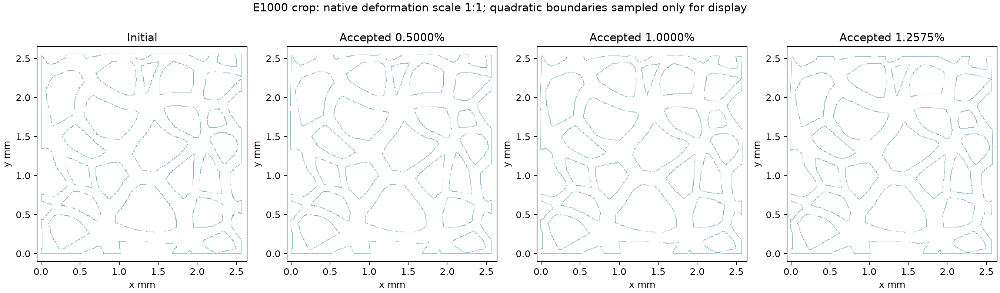
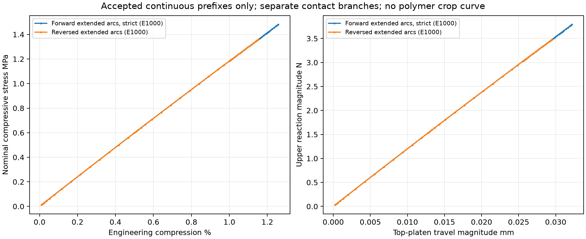
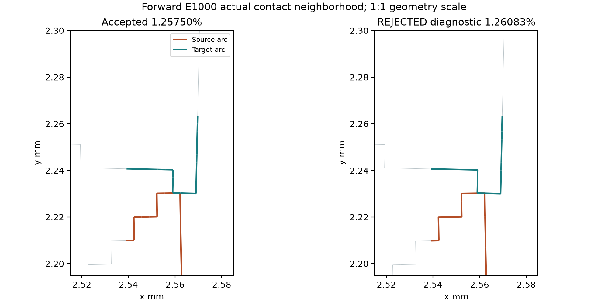

# Actual deformation and native fields

All crop plots show actual E1000 results, with deformation scale1. No simulated or magnified30%/40% crop state exists. Coupon40% is clearly separate.

`NATIVE_STRESS.png` contains native SXX,SYY,SXY,SEQV; `NATIVE_ELASTIC_STRAIN.png` contains native EPEL XX,YY,XY; `NATIVE_DISPLACEMENT.png` contains UX,UY and magnitude. All are at accepted1.2575%,LS5/SS8. Stress/strain values are native corner-node averages,47525 corners. No midside stress is filled. Visual linear interpolation across corner triangles is solely for display; color clipping is explicitly1st–99th percentile, while numeric extrema remain available. UX/UY are available for all174746 native nodes; rendered corner triangulation does not visualize every midside displacement. Boundary panels sample each exact quadratic edge solely for drawing; mechanical certificates use independent analytic/bounded procedures.

Maximum native displacement magnitude is0.0428178173946 mm. Native corner SYY ranges-67.967767 to22.1707435 MPa; SEQV maximum73.8016925 MPa. Native EPEL YY ranges-0.05538431879 to0.01547414346. These local strains exceed the global compression magnitude and are not an elastic failure limit for any real polymer. Hotspots are concentrated around narrow ligaments, notch transitions and loading boundaries; they lack mesh-convergence and yield/damage validation.

`NATIVE_CONTACT.png` plots actual status and endpoint pressure/penetration. Positive native penetration is overlap; signed gap can be obtained as its negative under the native convention. Empty/farfield contact fields remain unavailable, not fabricated values. The versioned final contact CSVs and raw full native datasets preserve native target IDs, force and endpoint measures. There are two closed selected exterior source faces, maximum pressure18.1137543 MPa, endpoint penetration8.53926394e−7 mm. These exterior-notch faces are distinct from internal pore contact, which remains open. There is no accepted evidence of pore closure, densification or global buckling/collapse; no mode classification is inferred from small local bending alone.

The conservative analytic TRI6 map minimum is2.72197936791e-06 mm² with zero invalid maps. Pore/boundary orientation is screened; small penalty overlap within tolerance is distinguished from unsupported crossings. The accepted state has a two-direction selected-arc continuous depth bound3.3646502e−6 mm; the next saved state is rejected for missing pressure-bearing support despite bounded small depth.

The final native fields were extracted twice in separate licensed read-only POST1 processes, from the authenticated new strict RST at LS5/SS8. Both extractions are byte-identical for all8 scientific CSVs, including full tensor fields, displacement, reactions, platen status/force and general/selected-contact records. The repeated U and selected-pair CSV also match the original all-state extraction. `fields/REPEAT_READBACK.json` binds source RST, final gate and scientific hashes; source input and native setup are authenticated in each readback manifest. Raw tensor CSVs remain outside Git under `final_readback_001/` and`002/`.

For the polymer coupon, native normal EPEL is logarithmic (EPEL YY=log0.6 at40%) and native SYY agrees with Cauchy stress. The old E1000 crop EPEL stays labeled with its native measure and material branch; it is not reinterpreted as a calibrated polymer strain. Native shear convention is retained, without claiming independently verified nonlinear tensor-shear conversion. Reference-area reaction curves remain nominal throughout.

`figures/FIGURE_INVENTORY.json` records plot SHA256s, exact source state and field-repeat proof. Five key figures were visually reviewed for readable layout, actual-state labels and geometry scale; numerical checks are separate from visual display.
