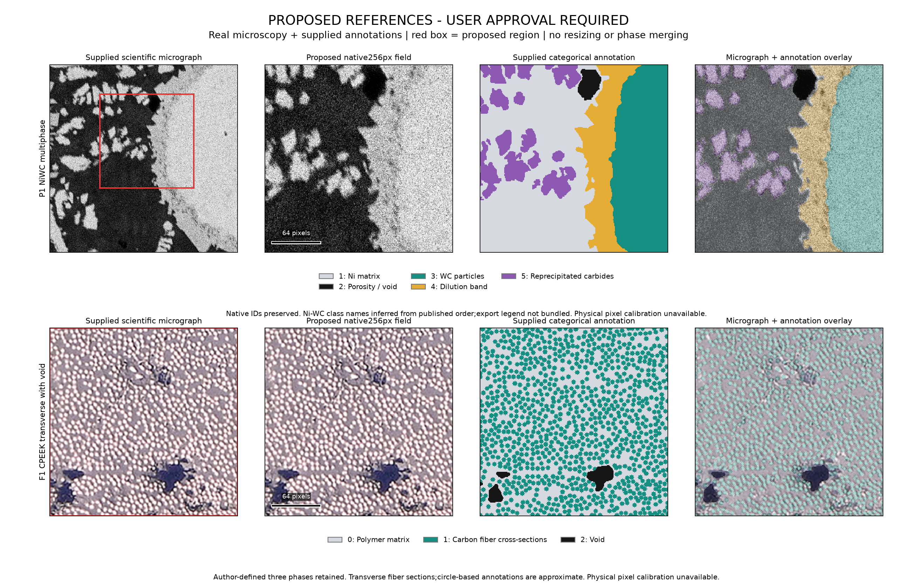
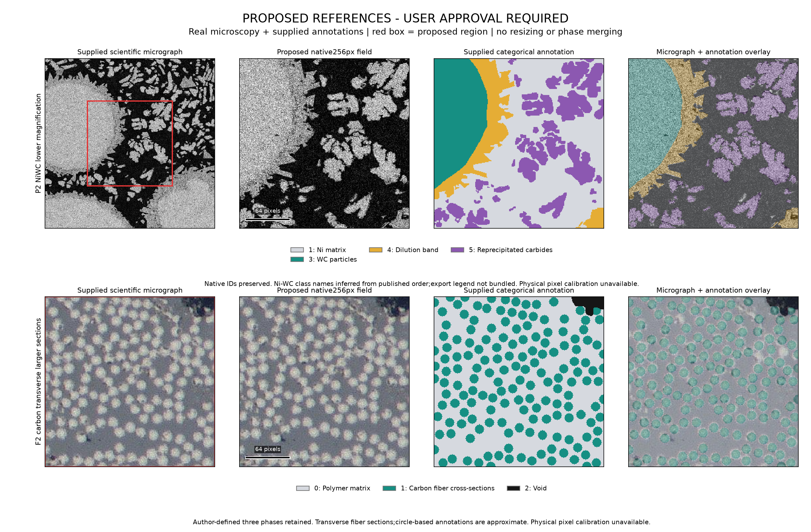

# v0.7.0 experimental correction: reference review

**Status: AWAITING_USER_REFERENCE_APPROVAL.** No new LLM call, reference freeze, ANSYS execution or mechanical optimization was performed in this correction. The existing synthetic pilot is preserved as framework/control evidence; it is not the main cross-family microscopy experiment.

## Proposed reference pair

Recommended review pair: **P1 + F1**. P2 and F2 are alternatives. These are proposals, not approved scientific targets. The proposed regions are native256×256 pixels with no resizing, thresholding, cleanup or phase merging. Larger source fields and raw categorical annotations are retained alongside the crops.

| Candidate | Source material | Native crop [x0,y0,x1,y1) | Raw-label fractions |
|---|---|---|---|
| F1 | Carbon-fiber reinforced PEEK (DatasetI explicitly identified as C/PEEK in author README) | `[0, 0, 256, 256]` | 0:52.773%, 1:45.270%, 2:1.958% |
| F2 | Carbon-fiber thermoplastic composite;test set includes C/PEEK and C/LM-PEAK. Filename-to-polymer subtype not established from supplied README. | `[0, 0, 256, 256]` | 0:63.254%, 1:35.410%, 2:1.337% |
| P1 | Directed-energy-deposited Ni-WC metal matrix composite | `[136, 80, 392, 336]` | 1:45.035%, 2:1.491%, 3:27.200%, 4:14.111%, 5:12.163% |
| P2 | Directed-energy-deposited Ni-WC metal matrix composite | `[128, 128, 384, 384]` | 1:48.943%, 3:18.633%, 4:10.754%, 5:21.671% |

P1 is from `sem1000_x768_y256_HorizontalFlip.bmp`. Its256px ROI is [136,80,392,336). It shows the coarse-carbide boundary, reaction/dilution region, finer precipitates and a pore. The ROI was selected from an8px grid to retain all native classes while minimizing source-to-crop phase-fraction change. It contains a partial coarse carbide, so it cannot establish a reliable complete-particle diameter distribution or an RVE. Edge-touching objects, including pores, must be censored in object-size measurements.

F1 is original DatasetI `2_3_2_L_cut_128_15616.tif`, with its author-supplied PNG annotation. DatasetI is explicitly C/PEEK in the README. This field is close to the median phase-fraction vector among DatasetI tiles with0.5%-10% annotated void. It includes45.270% fiber and1.958% void. The entire native256px tile is used. The nominal3px-radius fiber sections offer many instances but limited contour resolution.

P2 is a native central crop of `sem600_x0_y0_HorizontalFlip.bmp`. It provides an alternative field at lower stated acquisition magnification and more fine-carbide geometry; its source has no label2 pore annotation. F2 is test tile `2-6-1_mid_768_1792.jpg`, with larger nominal7px-radius fiber sections and1.337% annotated void. It is easier to inspect visually, but the supplied README does not establish a filename-to-polymer subtype map for this test tile. No exact PEEK/LM-PEAK attribution is invented for F2.

## Provenance and phase interpretation

Ni-WC source: Mutahar Safdar(2025), [SEM dataset, Zenodo17315241](https://zenodo.org/records/17315241), DOI10.5281/zenodo.17315241, **CC BY4.0**. The supplied image and mask archives match both published MD5 checksums. The archive contains405 augmented tiles derived from a smaller set of source regions. Selection excludes elastic/grid distortion variants and uses only geometry-preserving horizontal flips. These are supplied augmented scientific SEM crops, not untouched full acquisition micrographs. Neighboring crops overlap; augmentation variants cannot be counted as independent specimens.

The associated [materials-characterization publication](https://doi.org/10.1016/j.matchar.2025.115645) identifies matrix, porosity, carbide, dilution and reprecipitation classes. Downloaded masks use IDs1–5, whereas the described training class order is zero-based. The displayed names map native1→matrix,2→void,3→carbide,4→dilution and5→reprecipitated carbide. **This offset mapping is inferred from the published order and paired visual inspection; an explicit export legend was not bundled. It remains provisional until independently confirmed.** No native ID has been changed. Raw0, if encountered elsewhere, remains unknown/unassigned and is never silently treated as matrix. The annotation classes include material regions rather than five independently calibrated mechanical materials.

Fiber source: Merit Fernhout(2023), [4TU dataset](https://doi.org/10.4121/bf11171a-1f57-4a8a-9768-757850d13665), independently described by the [University of Twente](https://research.utwente.nl/en/datasets/annotated-images-of-microscopy-images-from-carbon-fibre-composite-2/), **CC0_1.0**. The original archive and inner archive are SHA256-bound; no unobserved published checksum is claimed. The author README explicitly defines **0=matrix,1=fiber,2=void**. Original image tiles are used instead of augmentation variants.

These are **transverse sections of fibers**. Their2D component diameters/packing can be measured; their longitudinal fiber lengths, curvature and in-plane orientation distribution cannot be recovered from these images. The author located centers and drew circles using an average radius; voids came from minimum-based thresholding. Therefore the masks are approximate annotations, not exact measured physical fiber contours. This uncertainty must carry into any LLM accuracy claim.

Neither selected source establishes a calibrated micrometers-per-pixel value in the supplied tile metadata/README. Rulers are labeled **pixels**. Magnification, image DPI and nominal fiber radius are not substituted for physical calibration. No material properties, physical specimen dimensions or stress–strain values were assigned.

## Honest inventory of the preceding setup

| Existing trial/control | Evidence classification | Actual outputs |
|---|---|---:|
| `baseline_fiber` | NON_LLM_PROCEDURAL_BASELINE | 20 |
| `baseline_particle` | NON_LLM_PROCEDURAL_BASELINE | 20 |
| `fiber_A_01` | PROMPT_ONLY_NOT_EXECUTED | NOT_EVALUATED |
| `fiber_A_02` | PROMPT_ONLY_NOT_EXECUTED | NOT_EVALUATED |
| `fiber_B_01` | PROMPT_ONLY_NOT_EXECUTED | NOT_EVALUATED |
| `fiber_B_02` | PROMPT_ONLY_NOT_EXECUTED | NOT_EVALUATED |
| `fiber_C_01` | PROMPT_ONLY_NOT_EXECUTED | NOT_EVALUATED |
| `fiber_C_02` | PROMPT_ONLY_NOT_EXECUTED | NOT_EVALUATED |
| `particle_A_01` | GENUINE_RETURNED_LLM_GENERATOR | 20 |
| `particle_A_02` | GENUINE_SUBMITTED_CHAT_RESPONSE_NOT_INGESTED | NOT_EVALUATED |
| `particle_B_01` | PROMPT_ONLY_NOT_EXECUTED | NOT_EVALUATED |
| `particle_B_02` | PROMPT_ONLY_NOT_EXECUTED | NOT_EVALUATED |
| `particle_C_01` | PROMPT_ONLY_NOT_EXECUTED | NOT_EVALUATED |
| `particle_C_02` | PROMPT_ONLY_NOT_EXECUTED | NOT_EVALUATED |

- **NON_LLM_PROCEDURAL_BASELINE:** two researcher/Codex-authored implementation controls,40 executed outputs total across development/held-out seeds. These are not independent experimental ChatGPT generations.
- **One verified returned experimental LLM script:** `particle_A_01`, a genuine ordinary ChatGPT call, with10 development and10 held-out outputs. Its target was synthetic, so this is only the preceding synthetic pilot.
- **One additional genuine submitted chat:** `particle_A_02`, URL recorded and submission verified in the preceding UI session. Its response was not ingested, so it is not counted as a second captured/evaluated generator.
- **Ten unused initial prompt packets:** remaining particle B/C and all fiber A/B/C prompts. Zero feedback calls and zero real-micrograph LLM trials.
- Analytical fixtures, metric tests, baseline runs, prepared prompts and source-code infrastructure are not relabeled as LLM experiments.

All preceding scripts, responses, reference pixels, outputs and verification files are hash-inventoried in `audit/PRIOR_EVIDENCE_HASHES.json`. The only pending prior-turn change at correction start was the A02 submission metadata; it was committed as preserved evidence rather than reset. Synthetic reference arrays remain immutable controls and will not be promoted to corrected primary targets.

## Authorized model interface and next executable plan

The ordinary ChatGPT browser interface was genuinely used for A01 and A02; no API credential or paid external endpoint was required. The UI exposed “ChatGPT” and “High”, not a verified backend/model version. Tokens and cost were unavailable. Normal Chat mode was used, not Codex or Work. Exact model/version must remain unavailable unless the UI exposes it. Ordinary-chat personalization/memory and backend routing were not independently controlled.

See `NEXT_PILOT_PLAN.md`. The existing worker assumes binary0/1 labels and the old fiber evaluator assumes longitudinal components. **They are not ready for these corrected references.** Approval must precede any new frozen targets or actual main experiment. After approval, categorical validators and transverse-fiber measurements must be independently checked, Ni-WC export IDs confirmed or retained as explicitly provisional, then prompts can be frozen. No automatic experiment starts from this delivery.

## Verification and preservation

Exact-crop tests verify source-mask SHA256, native array equality, retained class sets, nonzero voids, no invented physical scale, figure hashes and the approval gate. Prior evidence hashes are unchanged. Full active and archived replay results, when completed, are recorded in `verification/TEST_SUMMARY.json`; passing integrity tests do not imply an LLM microscopy reconstruction result.

No original full specimen, contact repair, crop compression or solver execution was attempted. The previous mechanics status remains `HOLD_CONTACT_ONSET__POLYMER_CROP_NOT_EXECUTED__THIRTY_PERCENT_NOT_ACHIEVED`. Nothing was pushed. Exact commits through the evidence phase are in the review handoff; the final reporting commit is supplied with the final response.

**Decision required:** approve P1+F1, choose P2 and/or F2, or request a different native region. The displayed Ni-WC names are provisional. This correction stops at reference review.
