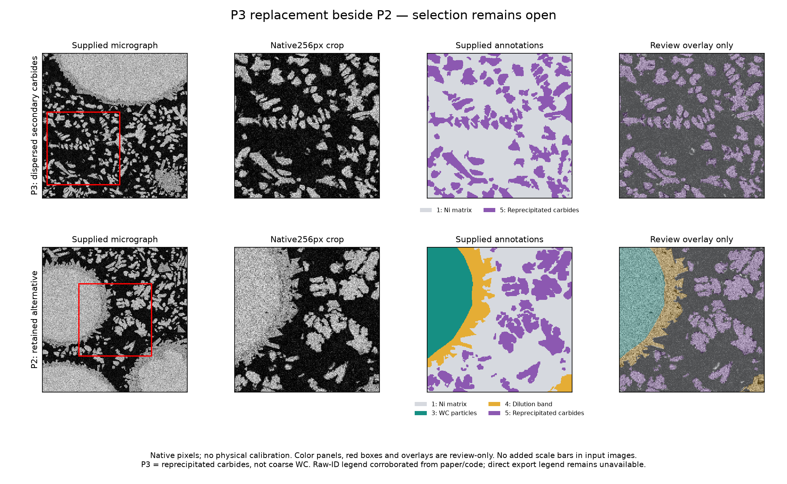

# Reference preparation following user review

P1 is rejected as the primary particle target and retained unchanged, including its original source bytes and native multiphase mask, as an optional advanced reference. P2 remains available. F1 is conditionally approved and prepared as a three-phase transverse C/PEEK reference. No prior experiment, generator, descriptor output or candidate record was overwritten.

## F1 prepared

`fiber/F1_transverse_CPEEK/llm_image_only/ORIGINAL_MICROGRAPH_256.png` is an exact pixel copy of the original unaugmented TIFF field, losslessly encoded as PNG. It contains no added overlays, text, annotation colors or 64-pixel ruler. Matrix 0, carbon fiber 1 and void 2 are distinct evaluator labels. Both matrix and fiber are solid. Void is never converted into matrix or reinforcement. The mask is in `evaluation_only`, outside the single-image model attachment directory.

The source author describes local-maxima fiber centers with perfect circles at the mean radius, and minimum-threshold void annotations. Dataset I is C/PEEK with nominal 3 px radius. These contours are approximate. Touching circles can form one connected annotation region, so region counts, equivalent diameters and centroid spacings are proxies, not physical fiber-instance truth. The new transverse observer reports per-phase fractions/S2/connectivity, phase-pair pixel-edge interfaces, complete-region diameter/aspect/spacing and void/censoring summaries. It does not use longitudinal fiber length, curvature or fiber-axis orientation. Historical binary descriptors remain available only to historical experiments. These are preparation diagnostics, not yet registered experiment scores.

Author definition: [4TU dataset](https://doi.org/10.4121/bf11171a-1f57-4a8a-9768-757850d13665); the original README and archive/member hashes are retained in the preceding correction record.

## P3 beside P2

P3 is a matrix-rich field from the real Ni-WC composite, containing dispersed **secondary reprecipitated carbides**, rather than surviving coarse WC. Native crop [16,208,272,464) of `sem600_x768_y448_HorizontalFlip.bmp`: matrix 68.367%, carbide 31.633%; 78 four-connected annotated regions,57 complete and 21 boundary-censored. The largest region is 5.56% of reinforcement area. Raw labels 1 and 5 are retained without merging. Other source phases lie outside this spatial crop; full source annotations are preserved. Selection searched all geometry-preserving tiles on a 16 px grid; 499 crops qualified, ranked by the smallest largest-region fraction, then number of complete regions. It is a morphology-selected local field, not an unbiased bulk RVE or independent specimen.

P2 retains matrix, coarse carbide, dilution and reprecipitate regions; its central crop has no void label. It remains an alternative, not a binary particle field. P1 stays archived as the advanced five-phase option.

### Annotation and input provenance limits

The human mask/image pairs and archive checksums are verified. Semantic IDs 1=matrix, 2=void, 3=coarse carbide, 4=dilution, 5=reprecipitate are corroborated by the paper's class order and the author's `reduce_zero_label=True` training configuration (raw 1 maps to training 0). The paper explicitly calls training-index 1 porosity. The exact raw-ID export legend/custom dataset metadata is absent from the downloaded files and author repository. This corroboration must not be called direct author-export verification. Therefore P3 is **review-only**, with a remaining phase-legend verification gate.

The supplied particle archive has augmented variants; selected HorizontalFlip pixels preserve geometry but are not original acquisition bytes. P3 and P2 are not yet authorized model attachments under the user's original-micrograph requirement. An original tile/confirmed inverse-flip reconstruction provenance is still needed. No segmentation-derived or manually authored replacement image will be used to bypass either gate.

Primary evidence: [Safdar dataset, CC BY4.0](https://zenodo.org/records/17315241), [paper](https://doi.org/10.1016/j.matchar.2025.115645), [author configuration](https://github.com/Mutahar-Safdar/SEM_Segmentation_ViTs/blob/main/Segformer%20%2B%20ViT.ipynb), [MMSegmentation label-offset definition](https://mmsegmentation.readthedocs.io/en/latest/notes/faq.html#functionality-of-reduce-zero-label). Author configuration Git blob 167fd9f3680ee9faf958151a4679496bcdc36c07. Paper support is a class-order cross-check, not a bundled raw-ID legend.

Follow-up research located Dylan Rose's original optical Ni-WC image/ground-truth dataset DOI10.17632/2wmbc95xy9.1 and produced P4. Its directly documented WC/non-WC annotations resolve the semantic-ID problem for that alternative, but do not verify P3. See [P4 verified annotation alternative](P4_VERIFIED_ANNOTATION_ALTERNATIVE.md) for the source, checksum, native crop, JPEG-mask decoding and absence of independent void annotation. P3 remains the user's preferred morphology pending verification. Annotated TiO2 powder datasets lack an embedded composite matrix; Al/B4C images lack verified masks, so neither was substituted.

## Input separation and next trial gate

**Confirmed:** the old displayed 64-pixel rulers, review overlays, red crop rectangles, legends and phase-color panels are generated in separate review figures. They are absent from the prepared F1 model image and the clean particle review crops. Exact array equality to the source crop is tested; the clean crops are not screenshots. No micrometer scale is inferred from pixel counts, magnification, nominal fiber radius or image metadata. Physical pixel calibration remains unknown.

No new LLM trials were submitted. The future A/B/C contract requires identical original micrograph inputs and phase definitions; masks remain evaluator-only, including in image-only A. After both targets and provenance are approved, categorical execution/scoring must be frozen and actual independent regular ChatGPT scripts collected. Prepared prompts, historical synthetic trials, and hand-authored controls do not count as those trials. Scripts and full responses must be retained without out-of-budget manual repairs. Nothing is pushed automatically.

The user prefers P3's morphology pending verification. P4 is an additional directly documented WC/non-WC annotation option, shown beside P2 for review; it has not silently replaced that preference. F1 preparation is complete. P3 verification remains incomplete, and no particle target is finally approved for trials.
