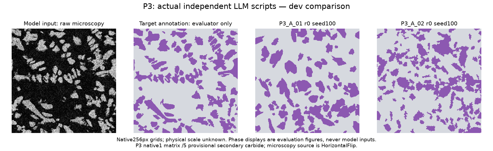
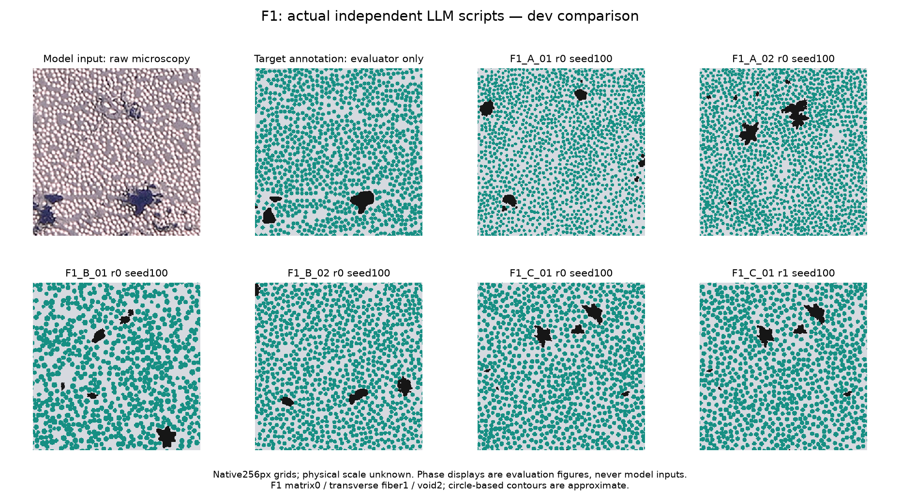

# P3 + F1 real microscopy LLM pilot

Actual independently returned initial scripts: **3**; paired feedback revisions: **0**. Submission events: 3. Prepared initial packets: 12; unexecuted packets are not trials.

| Script | Revision | Seeds | Valid / requested | Failures | Visible error | Hidden error | Hamming diversity |
|---|---:|---|---:|---:|---:|---:|---:|
| F1_A_01 | 0 | dev | 10/10 | 0 | 0.3322 | 0.2804 | 0.5009 |
| P3_A_01 | 0 | dev | 10/10 | 0 | 0.1466 | 0.101 | 0.4168 |
| P3_A_02 | 0 | dev | 10/10 | 0 | 0.1902 | 0.08583 | 0.4156 |

Errors are absolute descriptor differences divided by prospectively fixed scales, averaged equally within each group; lower is closer, not percentage accuracy. A script mean is NA unless every requested output has a complete group score. Validity and execution failures remain separate. Hamming distance measures variation among nested seeds, not reference accuracy.

## P3 descriptor comparison

| Script/revision/partition | Descriptor | Target | Generated seed mean ± SD | Available outputs |
|---|---|---:|---:|---:|
| P3_A_01/r0/dev | reinforcement_fraction (visible) | 0.3163 | 0.2947 ± 0.0148 | 10/10 |
| P3_A_01/r0/dev | complete_regions (visible) | 57 | 40.2 ± 4.142 | 10/10 |
| P3_A_01/r0/dev | diameter_mean_px (visible) | 15.71 | 17.04 ± 0.8624 | 10/10 |
| P3_A_01/r0/dev | diameter_std_px (visible) | 8.893 | 11.05 ± 1.366 | 10/10 |
| P3_A_01/r0/dev | aspect_mean (visible) | 1.916 | 1.736 ± 0.0815 | 10/10 |
| P3_A_01/r0/dev | nearest_neighbor_mean_px (hidden) | 19.45 | 23.11 ± 1.614 | 10/10 |
| P3_A_01/r0/dev | nearest_neighbor_cv (hidden) | 0.487 | 0.3515 ± 0.07651 | 10/10 |
| P3_A_01/r0/dev | interface_density (hidden) | 0.1126 | 0.08701 ± 0.004858 | 10/10 |
| P3_A_01/r0/dev | S2_x_8 (hidden) | 0.1624 | 0.1633 ± 0.00765 | 10/10 |
| P3_A_01/r0/dev | S2_y_8 (hidden) | 0.1529 | 0.1629 ± 0.0103 | 10/10 |
| P3_A_01/r0/dev | matrix_lcc (hidden) | 0.9906 | 0.9895 ± 0.01127 | 10/10 |
| P3_A_02/r0/dev | reinforcement_fraction (visible) | 0.3163 | 0.2987 ± 0.01546 | 10/10 |
| P3_A_02/r0/dev | complete_regions (visible) | 57 | 84.5 ± 4.717 | 10/10 |
| P3_A_02/r0/dev | diameter_mean_px (visible) | 15.71 | 10.4 ± 0.6976 | 10/10 |
| P3_A_02/r0/dev | diameter_std_px (visible) | 8.893 | 9.501 ± 0.8938 | 10/10 |
| P3_A_02/r0/dev | aspect_mean (visible) | 1.916 | 1.832 ± 0.1011 | 10/10 |
| P3_A_02/r0/dev | nearest_neighbor_mean_px (hidden) | 19.45 | 15.05 ± 1.317 | 10/10 |
| P3_A_02/r0/dev | nearest_neighbor_cv (hidden) | 0.487 | 0.5443 ± 0.0585 | 10/10 |
| P3_A_02/r0/dev | interface_density (hidden) | 0.1126 | 0.1209 ± 0.00567 | 10/10 |
| P3_A_02/r0/dev | S2_x_8 (hidden) | 0.1624 | 0.146 ± 0.01084 | 10/10 |
| P3_A_02/r0/dev | S2_y_8 (hidden) | 0.1529 | 0.1438 ± 0.01181 | 10/10 |
| P3_A_02/r0/dev | matrix_lcc (hidden) | 0.9906 | 0.9931 ± 0.006897 | 10/10 |

## F1 descriptor comparison

| Script/revision/partition | Descriptor | Target | Generated seed mean ± SD | Available outputs |
|---|---|---:|---:|---:|
| F1_A_01/r0/dev | fiber_fraction (visible) | 0.4527 | 0.3993 ± 0.008657 | 10/10 |
| F1_A_01/r0/dev | void_fraction (visible) | 0.01958 | 0.01846 ± 0.003234 | 10/10 |
| F1_A_01/r0/dev | complete_fiber_regions (visible) | 464 | 923.9 ± 18.05 | 10/10 |
| F1_A_01/r0/dev | fiber_diameter_mean_px (visible) | 7.905 | 5.495 ± 0.0591 | 10/10 |
| F1_A_01/r0/dev | fiber_diameter_std_px (visible) | 2.812 | 1.783 ± 0.1494 | 10/10 |
| F1_A_01/r0/dev | fiber_nearest_neighbor_mean_px (hidden) | 8.346 | 6.389 ± 0.03829 | 10/10 |
| F1_A_01/r0/dev | fiber_S2_x_8 (hidden) | 0.2296 | 0.1747 ± 0.007642 | 10/10 |
| F1_A_01/r0/dev | fiber_S2_y_8 (hidden) | 0.2138 | 0.1739 ± 0.007378 | 10/10 |
| F1_A_01/r0/dev | matrix_fiber_interface (hidden) | 0.3951 | 0.3858 ± 0.007371 | 10/10 |
| F1_A_01/r0/dev | matrix_lcc (hidden) | 0.93 | 0.9903 ± 0.002446 | 10/10 |
| F1_A_01/r0/dev | void_regions (hidden) | 4 | 10.3 ± 2.147 | 10/10 |
| F1_A_01/r0/dev | void_diameter_mean_px (hidden) | 21.9 | 10.17 ± 1.675 | 10/10 |
| F1_A_01/r0/dev | void_S2_x_8 (hidden) | 0.01148 | 0.007513 ± 0.002005 | 10/10 |

## Figures and interpretation

Each figure shows the fixed first seed of its partition (development100 or heldout0), chosen prospectively rather than for appearance. The original microscopy image is the model input; phase-colored target panels are evaluator-only. Generated panels come from captured ChatGPT scripts, without researcher repairs.

The small pilot supports descriptive comparisons between independent scripts on two selected fields. Seeds are nested, not independent LLM trials. Condition C receives extra interaction; there is no equal-attempt control for a causal feedback-only claim. Fresh initial ordinary chats were used, but account personalization, memory, connected context and hidden model routing are not controlled; the home screen surfaced project-related suggestions. Only ChatGPT and High effort are exposed; exact backend/version, tokens and cost are unavailable.

P3 is a morphology-selected, horizontally flipped SEM augmentation. Native IDs1/5 are retained; label5 is only provisionally reprecipitated carbide. This is not an unbiased RVE or fully verified chemical map. F1 is original C/PEEK transverse microscopy with distinct matrix0/fiber1/void2; mean-radius circle and void-threshold annotation uncertainty limits region geometry and physical instance interpretation. Both targets lack physical pixel calibration. No mechanical properties, ANSYS results, cross-material generalization, p-values or optimization claims are inferred. Heldout results remain locked until all scripts/revisions are frozen.
