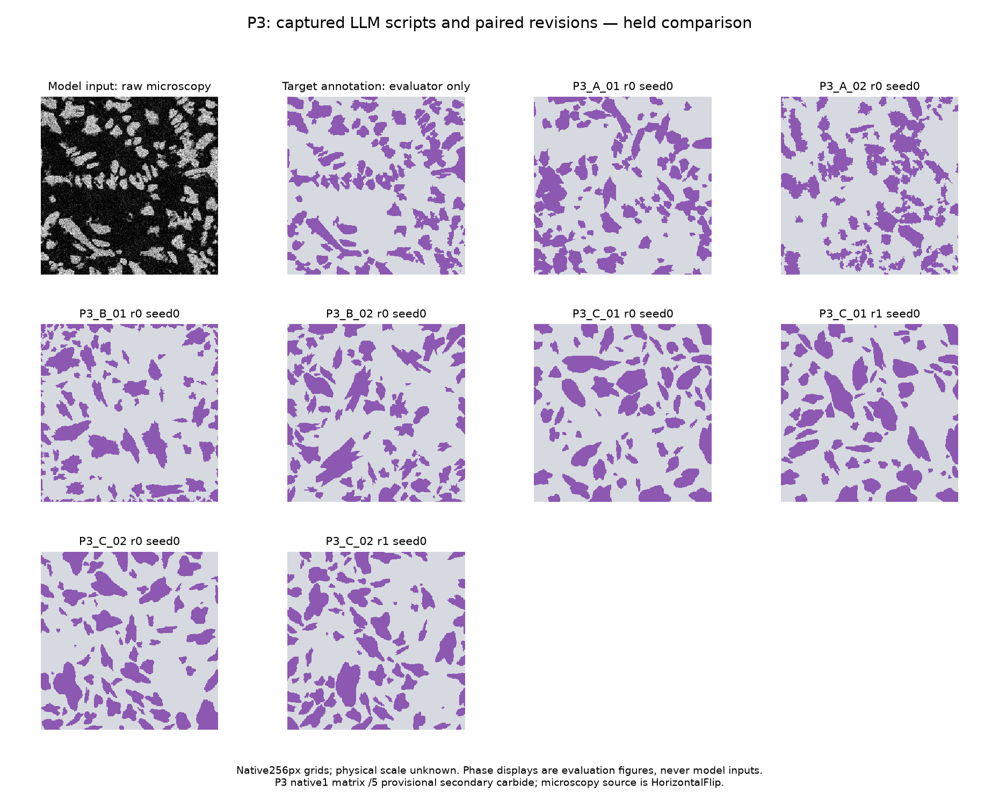
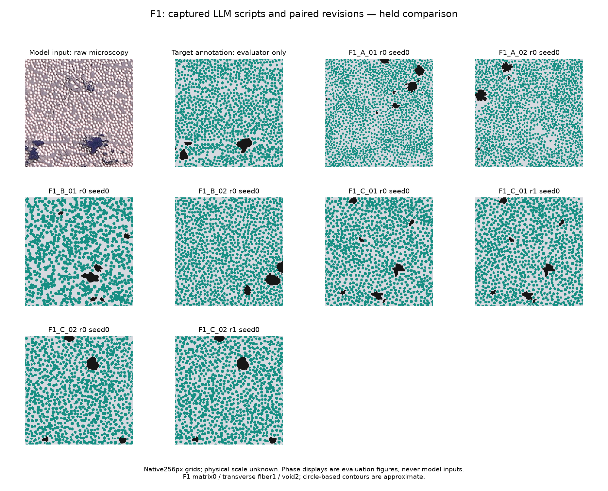

# P3 + F1 real microscopy LLM pilot

Actual independently returned initial scripts: **12**; paired feedback revisions: **4**. Submission events: 16. Prepared initial packets: 12; unexecuted packets are not trials.

| Script | Revision | Seeds | Valid / requested | Failures | Visible error | Hidden error | Hamming diversity |
|---|---:|---|---:|---:|---:|---:|---:|
| F1_A_01 | 0 | dev | 10/10 | 0 | 0.3322 | 0.2804 | 0.5009 |
| F1_A_01 | 0 | held | 10/10 | 0 | 0.329 | 0.2889 | 0.5011 |
| F1_A_02 | 0 | dev | 10/10 | 0 | 0.1996 | 0.2488 | 0.5141 |
| F1_A_02 | 0 | held | 10/10 | 0 | 0.1945 | 0.2358 | 0.5136 |
| F1_B_01 | 0 | dev | 10/10 | 0 | 0.3239 | 0.2183 | 0.5162 |
| F1_B_01 | 0 | held | 10/10 | 0 | 0.3191 | 0.2341 | 0.5175 |
| F1_B_02 | 0 | dev | 10/10 | 0 | 0.03205 | 0.1056 | 0.5139 |
| F1_B_02 | 0 | held | 10/10 | 0 | 0.02808 | 0.1179 | 0.5154 |
| F1_C_01 | 0 | dev | 10/10 | 0 | 0.01807 | 0.1748 | 0.5141 |
| F1_C_01 | 0 | held | 10/10 | 0 | 0.01805 | 0.1846 | 0.516 |
| F1_C_01 | 1 | dev | 10/10 | 0 | 0.01276 | 0.1806 | 0.5148 |
| F1_C_01 | 1 | held | 10/10 | 0 | 0.01225 | 0.1828 | 0.5167 |
| F1_C_02 | 0 | dev | 10/10 | 0 | 0.0207 | 0.1408 | 0.5163 |
| F1_C_02 | 0 | held | 10/10 | 0 | 0.01776 | 0.1571 | 0.5153 |
| F1_C_02 | 1 | dev | 10/10 | 0 | 0.008521 | 0.1347 | 0.516 |
| F1_C_02 | 1 | held | 10/10 | 0 | 0.00734 | 0.1515 | 0.5166 |
| P3_A_01 | 0 | dev | 10/10 | 0 | 0.1466 | 0.101 | 0.4168 |
| P3_A_01 | 0 | held | 10/10 | 0 | 0.1185 | 0.1068 | 0.4217 |
| P3_A_02 | 0 | dev | 10/10 | 0 | 0.1902 | 0.08583 | 0.4156 |
| P3_A_02 | 0 | held | 10/10 | 0 | 0.1635 | 0.09176 | 0.4122 |
| P3_B_01 | 0 | dev | 10/10 | 0 | 0.04088 | 0.08736 | 0.3941 |
| P3_B_01 | 0 | held | 10/10 | 0 | 0.04064 | 0.09102 | 0.3876 |
| P3_B_02 | 0 | dev | 10/10 | 0 | 0.01202 | 0.07537 | 0.4246 |
| P3_B_02 | 0 | held | 10/10 | 0 | 0.009956 | 0.07562 | 0.4238 |
| P3_C_01 | 0 | dev | 10/10 | 0 | 0.01544 | 0.1013 | 0.4297 |
| P3_C_01 | 0 | held | 10/10 | 0 | 0.02023 | 0.09663 | 0.43 |
| P3_C_01 | 1 | dev | 10/10 | 0 | 0.01518 | 0.1081 | 0.4233 |
| P3_C_01 | 1 | held | 10/10 | 0 | 0.015 | 0.1022 | 0.4311 |
| P3_C_02 | 0 | dev | 10/10 | 0 | 0.007566 | 0.07921 | 0.4235 |
| P3_C_02 | 0 | held | 10/10 | 0 | 0.01075 | 0.08831 | 0.4215 |
| P3_C_02 | 1 | dev | 10/10 | 0 | 0.006432 | 0.07896 | 0.4213 |
| P3_C_02 | 1 | held | 10/10 | 0 | 0.008201 | 0.0789 | 0.4241 |

Errors are absolute descriptor differences divided by prospectively fixed scales, averaged equally within each group; lower is closer, not percentage accuracy. A script mean is NA unless every requested output has a complete group score. Validity and execution failures remain separate. Hamming distance measures variation among nested seeds, not reference accuracy.

## Descriptive condition comparison

| Family | Condition/revision | Partition | Parent scripts | Valid/requested | Visible error | Hidden error | Hamming diversity |
|---|---|---|---:|---:|---:|---:|---:|
| F1 | A/r0 | dev | 2 | 20/20 | 0.2659 | 0.2646 | 0.5075 |
| F1 | A/r0 | held | 2 | 20/20 | 0.2617 | 0.2623 | 0.5074 |
| F1 | B/r0 | dev | 2 | 20/20 | 0.178 | 0.162 | 0.5151 |
| F1 | B/r0 | held | 2 | 20/20 | 0.1736 | 0.176 | 0.5164 |
| F1 | C/r0 | dev | 2 | 20/20 | 0.01939 | 0.1578 | 0.5152 |
| F1 | C/r0 | held | 2 | 20/20 | 0.01791 | 0.1708 | 0.5157 |
| F1 | C/r1 | dev | 2 | 20/20 | 0.01064 | 0.1577 | 0.5154 |
| F1 | C/r1 | held | 2 | 20/20 | 0.009794 | 0.1672 | 0.5167 |
| P3 | A/r0 | dev | 2 | 20/20 | 0.1684 | 0.0934 | 0.4162 |
| P3 | A/r0 | held | 2 | 20/20 | 0.141 | 0.09927 | 0.4169 |
| P3 | B/r0 | dev | 2 | 20/20 | 0.02645 | 0.08136 | 0.4093 |
| P3 | B/r0 | held | 2 | 20/20 | 0.0253 | 0.08332 | 0.4057 |
| P3 | C/r0 | dev | 2 | 20/20 | 0.0115 | 0.09023 | 0.4266 |
| P3 | C/r0 | held | 2 | 20/20 | 0.01549 | 0.09247 | 0.4258 |
| P3 | C/r1 | dev | 2 | 20/20 | 0.01081 | 0.09355 | 0.4223 |
| P3 | C/r1 | held | 2 | 20/20 | 0.0116 | 0.09056 | 0.4276 |

Condition values average script means equally. C/r0 and C/r1 share the same parent trials; they cannot be added as independent samples. Any missing script score makes its condition score unavailable. JSON tables retain scoring coverage and descriptive between-script SD; this small pilot does not support significance claims.

| Paired parent | Partition | Valid before/after | Visible error change | Hidden error change | Diversity change |
|---|---|---:|---:|---:|---:|
| F1_C_01 | dev | 10/10 | -0.005314 | 0.005771 | 0.0007626 |
| F1_C_01 | held | 10/10 | -0.005805 | -0.001797 | 0.0007222 |
| F1_C_02 | dev | 10/10 | -0.01218 | -0.006108 | -0.0003506 |
| F1_C_02 | held | 10/10 | -0.01042 | -0.005578 | 0.001279 |
| P3_C_01 | dev | 10/10 | -0.0002628 | 0.006885 | -0.006406 |
| P3_C_01 | held | 10/10 | -0.005223 | 0.005601 | 0.001093 |
| P3_C_02 | dev | 10/10 | -0.001134 | -0.0002464 | -0.002236 |
| P3_C_02 | held | 10/10 | -0.002546 | -0.009409 | 0.002557 |

Changes are revised minus initial script means. Negative error change is closer agreement; diversity change has no reference-accuracy interpretation.

## P3 descriptor comparison

| Script/revision/partition | Descriptor | Target | Generated seed mean ± SD | Available outputs |
|---|---|---:|---:|---:|
| P3_A_01/r0/dev | reinforcement_fraction (visible) | 0.3163 | 0.2947 ± 0.0148 | 10/10 |
| P3_A_01/r0/dev | complete_regions (visible) | 57 | 40.2 ± 4.142 | 10/10 |
| P3_A_01/r0/dev | diameter_mean_px (visible) | 15.71 | 17.04 ± 0.8624 | 10/10 |
| P3_A_01/r0/dev | diameter_std_px (visible) | 8.893 | 11.05 ± 1.366 | 10/10 |
| P3_A_01/r0/dev | aspect_mean (visible) | 1.916 | 1.736 ± 0.0815 | 10/10 |
| P3_A_01/r0/dev | nearest_neighbor_mean_px (hidden) | 19.45 | 23.11 ± 1.614 | 10/10 |
| P3_A_01/r0/dev | nearest_neighbor_cv (hidden) | 0.487 | 0.3515 ± 0.07651 | 10/10 |
| P3_A_01/r0/dev | interface_density (hidden) | 0.1126 | 0.08701 ± 0.004858 | 10/10 |
| P3_A_01/r0/dev | S2_x_8 (hidden) | 0.1624 | 0.1633 ± 0.00765 | 10/10 |
| P3_A_01/r0/dev | S2_y_8 (hidden) | 0.1529 | 0.1629 ± 0.0103 | 10/10 |
| P3_A_01/r0/dev | matrix_lcc (hidden) | 0.9906 | 0.9895 ± 0.01127 | 10/10 |
| P3_A_01/r0/held | reinforcement_fraction (visible) | 0.3163 | 0.302 ± 0.01367 | 10/10 |
| P3_A_01/r0/held | complete_regions (visible) | 57 | 43.4 ± 8.261 | 10/10 |
| P3_A_01/r0/held | diameter_mean_px (visible) | 15.71 | 16.36 ± 1.57 | 10/10 |
| P3_A_01/r0/held | diameter_std_px (visible) | 8.893 | 10.47 ± 1.644 | 10/10 |
| P3_A_01/r0/held | aspect_mean (visible) | 1.916 | 1.791 ± 0.1193 | 10/10 |
| P3_A_01/r0/held | nearest_neighbor_mean_px (hidden) | 19.45 | 23.75 ± 2.948 | 10/10 |
| P3_A_01/r0/held | nearest_neighbor_cv (hidden) | 0.487 | 0.3475 ± 0.0339 | 10/10 |
| P3_A_01/r0/held | interface_density (hidden) | 0.1126 | 0.09098 ± 0.007787 | 10/10 |
| P3_A_01/r0/held | S2_x_8 (hidden) | 0.1624 | 0.1639 ± 0.009133 | 10/10 |
| P3_A_01/r0/held | S2_y_8 (hidden) | 0.1529 | 0.1662 ± 0.01149 | 10/10 |
| P3_A_01/r0/held | matrix_lcc (hidden) | 0.9906 | 0.9898 ± 0.007088 | 10/10 |
| P3_A_02/r0/dev | reinforcement_fraction (visible) | 0.3163 | 0.2987 ± 0.01546 | 10/10 |
| P3_A_02/r0/dev | complete_regions (visible) | 57 | 84.5 ± 4.717 | 10/10 |
| P3_A_02/r0/dev | diameter_mean_px (visible) | 15.71 | 10.4 ± 0.6976 | 10/10 |
| P3_A_02/r0/dev | diameter_std_px (visible) | 8.893 | 9.501 ± 0.8938 | 10/10 |
| P3_A_02/r0/dev | aspect_mean (visible) | 1.916 | 1.832 ± 0.1011 | 10/10 |
| P3_A_02/r0/dev | nearest_neighbor_mean_px (hidden) | 19.45 | 15.05 ± 1.317 | 10/10 |
| P3_A_02/r0/dev | nearest_neighbor_cv (hidden) | 0.487 | 0.5443 ± 0.0585 | 10/10 |
| P3_A_02/r0/dev | interface_density (hidden) | 0.1126 | 0.1209 ± 0.00567 | 10/10 |
| P3_A_02/r0/dev | S2_x_8 (hidden) | 0.1624 | 0.146 ± 0.01084 | 10/10 |
| P3_A_02/r0/dev | S2_y_8 (hidden) | 0.1529 | 0.1438 ± 0.01181 | 10/10 |
| P3_A_02/r0/dev | matrix_lcc (hidden) | 0.9906 | 0.9931 ± 0.006897 | 10/10 |
| P3_A_02/r0/held | reinforcement_fraction (visible) | 0.3163 | 0.2911 ± 0.01603 | 10/10 |
| P3_A_02/r0/held | complete_regions (visible) | 57 | 76.6 ± 5.987 | 10/10 |
| P3_A_02/r0/held | diameter_mean_px (visible) | 15.71 | 10.39 ± 0.7794 | 10/10 |
| P3_A_02/r0/held | diameter_std_px (visible) | 8.893 | 9.876 ± 0.939 | 10/10 |
| P3_A_02/r0/held | aspect_mean (visible) | 1.916 | 1.902 ± 0.0474 | 10/10 |
| P3_A_02/r0/held | nearest_neighbor_mean_px (hidden) | 19.45 | 14.9 ± 1.343 | 10/10 |
| P3_A_02/r0/held | nearest_neighbor_cv (hidden) | 0.487 | 0.5608 ± 0.07559 | 10/10 |
| P3_A_02/r0/held | interface_density (hidden) | 0.1126 | 0.116 ± 0.007649 | 10/10 |
| P3_A_02/r0/held | S2_x_8 (hidden) | 0.1624 | 0.1434 ± 0.01017 | 10/10 |
| P3_A_02/r0/held | S2_y_8 (hidden) | 0.1529 | 0.1438 ± 0.0122 | 10/10 |
| P3_A_02/r0/held | matrix_lcc (hidden) | 0.9906 | 0.9891 ± 0.008277 | 10/10 |
| P3_B_01/r0/dev | reinforcement_fraction (visible) | 0.3163 | 0.287 ± 0.007229 | 10/10 |
| P3_B_01/r0/dev | complete_regions (visible) | 57 | 57 ± 0 | 10/10 |
| P3_B_01/r0/dev | diameter_mean_px (visible) | 15.71 | 15.7 ± 0.01326 | 10/10 |
| P3_B_01/r0/dev | diameter_std_px (visible) | 8.893 | 8.873 ± 0.04451 | 10/10 |
| P3_B_01/r0/dev | aspect_mean (visible) | 1.916 | 1.951 ± 0.08883 | 10/10 |
| P3_B_01/r0/dev | nearest_neighbor_mean_px (hidden) | 19.45 | 21.54 ± 0.6951 | 10/10 |
| P3_B_01/r0/dev | nearest_neighbor_cv (hidden) | 0.487 | 0.3317 ± 0.02725 | 10/10 |
| P3_B_01/r0/dev | interface_density (hidden) | 0.1126 | 0.09942 ± 0.001245 | 10/10 |
| P3_B_01/r0/dev | S2_x_8 (hidden) | 0.1624 | 0.1445 ± 0.007143 | 10/10 |
| P3_B_01/r0/dev | S2_y_8 (hidden) | 0.1529 | 0.1425 ± 0.006711 | 10/10 |
| P3_B_01/r0/dev | matrix_lcc (hidden) | 0.9906 | 0.9994 ± 0.0007057 | 10/10 |
| P3_B_01/r0/held | reinforcement_fraction (visible) | 0.3163 | 0.2815 ± 0.004623 | 10/10 |
| P3_B_01/r0/held | complete_regions (visible) | 57 | 57 ± 0 | 10/10 |
| P3_B_01/r0/held | diameter_mean_px (visible) | 15.71 | 15.7 ± 0.005108 | 10/10 |
| P3_B_01/r0/held | diameter_std_px (visible) | 8.893 | 8.891 ± 0.01194 | 10/10 |
| P3_B_01/r0/held | aspect_mean (visible) | 1.916 | 1.938 ± 0.04645 | 10/10 |
| P3_B_01/r0/held | nearest_neighbor_mean_px (hidden) | 19.45 | 21.48 ± 0.5391 | 10/10 |
| P3_B_01/r0/held | nearest_neighbor_cv (hidden) | 0.487 | 0.3445 ± 0.03634 | 10/10 |
| P3_B_01/r0/held | interface_density (hidden) | 0.1126 | 0.1002 ± 0.001566 | 10/10 |
| P3_B_01/r0/held | S2_x_8 (hidden) | 0.1624 | 0.14 ± 0.006388 | 10/10 |
| P3_B_01/r0/held | S2_y_8 (hidden) | 0.1529 | 0.1384 ± 0.005302 | 10/10 |
| P3_B_01/r0/held | matrix_lcc (hidden) | 0.9906 | 0.9995 ± 0.0003738 | 10/10 |
| P3_B_02/r0/dev | reinforcement_fraction (visible) | 0.3163 | 0.3162 ± 0.0006491 | 10/10 |
| P3_B_02/r0/dev | complete_regions (visible) | 57 | 57 ± 0 | 10/10 |
| P3_B_02/r0/dev | diameter_mean_px (visible) | 15.71 | 15.69 ± 0.01084 | 10/10 |
| P3_B_02/r0/dev | diameter_std_px (visible) | 8.893 | 8.901 ± 0.01371 | 10/10 |
| P3_B_02/r0/dev | aspect_mean (visible) | 1.916 | 1.985 ± 0.06485 | 10/10 |
| P3_B_02/r0/dev | nearest_neighbor_mean_px (hidden) | 19.45 | 20.43 ± 0.717 | 10/10 |
| P3_B_02/r0/dev | nearest_neighbor_cv (hidden) | 0.487 | 0.3216 ± 0.05668 | 10/10 |
| P3_B_02/r0/dev | interface_density (hidden) | 0.1126 | 0.0964 ± 0.00183 | 10/10 |
| P3_B_02/r0/dev | S2_x_8 (hidden) | 0.1624 | 0.1671 ± 0.002483 | 10/10 |
| P3_B_02/r0/dev | S2_y_8 (hidden) | 0.1529 | 0.1658 ± 0.005394 | 10/10 |
| P3_B_02/r0/dev | matrix_lcc (hidden) | 0.9906 | 0.9994 ± 0.0006211 | 10/10 |
| P3_B_02/r0/held | reinforcement_fraction (visible) | 0.3163 | 0.3164 ± 0.0004953 | 10/10 |
| P3_B_02/r0/held | complete_regions (visible) | 57 | 57 ± 0 | 10/10 |
| P3_B_02/r0/held | diameter_mean_px (visible) | 15.71 | 15.7 ± 0.01629 | 10/10 |
| P3_B_02/r0/held | diameter_std_px (visible) | 8.893 | 8.892 ± 0.01732 | 10/10 |
| P3_B_02/r0/held | aspect_mean (visible) | 1.916 | 1.94 ± 0.0858 | 10/10 |
| P3_B_02/r0/held | nearest_neighbor_mean_px (hidden) | 19.45 | 20.93 ± 0.677 | 10/10 |
| P3_B_02/r0/held | nearest_neighbor_cv (hidden) | 0.487 | 0.3335 ± 0.0359 | 10/10 |
| P3_B_02/r0/held | interface_density (hidden) | 0.1126 | 0.09741 ± 0.001796 | 10/10 |
| P3_B_02/r0/held | S2_x_8 (hidden) | 0.1624 | 0.1656 ± 0.003948 | 10/10 |
| P3_B_02/r0/held | S2_y_8 (hidden) | 0.1529 | 0.1662 ± 0.005124 | 10/10 |
| P3_B_02/r0/held | matrix_lcc (hidden) | 0.9906 | 0.9994 ± 0.0006996 | 10/10 |
| P3_C_01/r0/dev | reinforcement_fraction (visible) | 0.3163 | 0.3161 ± 0.0006016 | 10/10 |
| P3_C_01/r0/dev | complete_regions (visible) | 57 | 57 ± 0 | 10/10 |
| P3_C_01/r0/dev | diameter_mean_px (visible) | 15.71 | 15.65 ± 0.09898 | 10/10 |
| P3_C_01/r0/dev | diameter_std_px (visible) | 8.893 | 8.632 ± 0.4879 | 10/10 |
| P3_C_01/r0/dev | aspect_mean (visible) | 1.916 | 1.956 ± 0.08625 | 10/10 |
| P3_C_01/r0/dev | nearest_neighbor_mean_px (hidden) | 19.45 | 20.85 ± 0.6997 | 10/10 |
| P3_C_01/r0/dev | nearest_neighbor_cv (hidden) | 0.487 | 0.2982 ± 0.03119 | 10/10 |
| P3_C_01/r0/dev | interface_density (hidden) | 0.1126 | 0.08643 ± 0.002178 | 10/10 |
| P3_C_01/r0/dev | S2_x_8 (hidden) | 0.1624 | 0.1716 ± 0.008198 | 10/10 |
| P3_C_01/r0/dev | S2_y_8 (hidden) | 0.1529 | 0.1701 ± 0.00462 | 10/10 |
| P3_C_01/r0/dev | matrix_lcc (hidden) | 0.9906 | 0.9994 ± 0.0007804 | 10/10 |
| P3_C_01/r0/held | reinforcement_fraction (visible) | 0.3163 | 0.3162 ± 0.0004518 | 10/10 |
| P3_C_01/r0/held | complete_regions (visible) | 57 | 57 ± 0 | 10/10 |
| P3_C_01/r0/held | diameter_mean_px (visible) | 15.71 | 15.68 ± 0.0971 | 10/10 |
| P3_C_01/r0/held | diameter_std_px (visible) | 8.893 | 8.663 ± 0.4657 | 10/10 |
| P3_C_01/r0/held | aspect_mean (visible) | 1.916 | 2.003 ± 0.1168 | 10/10 |
| P3_C_01/r0/held | nearest_neighbor_mean_px (hidden) | 19.45 | 20.65 ± 0.787 | 10/10 |
| P3_C_01/r0/held | nearest_neighbor_cv (hidden) | 0.487 | 0.3279 ± 0.02666 | 10/10 |
| P3_C_01/r0/held | interface_density (hidden) | 0.1126 | 0.08642 ± 0.003038 | 10/10 |
| P3_C_01/r0/held | S2_x_8 (hidden) | 0.1624 | 0.1729 ± 0.007916 | 10/10 |
| P3_C_01/r0/held | S2_y_8 (hidden) | 0.1529 | 0.1707 ± 0.006872 | 10/10 |
| P3_C_01/r0/held | matrix_lcc (hidden) | 0.9906 | 0.9996 ± 0.0007786 | 10/10 |
| P3_C_01/r1/dev | reinforcement_fraction (visible) | 0.3163 | 0.3165 ± 0.0004481 | 10/10 |
| P3_C_01/r1/dev | complete_regions (visible) | 57 | 57 ± 0 | 10/10 |
| P3_C_01/r1/dev | diameter_mean_px (visible) | 15.71 | 15.7 ± 0.1122 | 10/10 |
| P3_C_01/r1/dev | diameter_std_px (visible) | 8.893 | 8.895 ± 0.5321 | 10/10 |
| P3_C_01/r1/dev | aspect_mean (visible) | 1.916 | 1.902 ± 0.07396 | 10/10 |
| P3_C_01/r1/dev | nearest_neighbor_mean_px (hidden) | 19.45 | 21.11 ± 1.141 | 10/10 |
| P3_C_01/r1/dev | nearest_neighbor_cv (hidden) | 0.487 | 0.3073 ± 0.05281 | 10/10 |
| P3_C_01/r1/dev | interface_density (hidden) | 0.1126 | 0.08508 ± 0.002273 | 10/10 |
| P3_C_01/r1/dev | S2_x_8 (hidden) | 0.1624 | 0.1744 ± 0.005294 | 10/10 |
| P3_C_01/r1/dev | S2_y_8 (hidden) | 0.1529 | 0.1724 ± 0.003065 | 10/10 |
| P3_C_01/r1/dev | matrix_lcc (hidden) | 0.9906 | 0.9997 ± 0.000589 | 10/10 |
| P3_C_01/r1/held | reinforcement_fraction (visible) | 0.3163 | 0.3162 ± 0.0005098 | 10/10 |
| P3_C_01/r1/held | complete_regions (visible) | 57 | 57 ± 0 | 10/10 |
| P3_C_01/r1/held | diameter_mean_px (visible) | 15.71 | 15.72 ± 0.1056 | 10/10 |
| P3_C_01/r1/held | diameter_std_px (visible) | 8.893 | 8.915 ± 0.504 | 10/10 |
| P3_C_01/r1/held | aspect_mean (visible) | 1.916 | 1.947 ± 0.08655 | 10/10 |
| P3_C_01/r1/held | nearest_neighbor_mean_px (hidden) | 19.45 | 20.92 ± 0.9977 | 10/10 |
| P3_C_01/r1/held | nearest_neighbor_cv (hidden) | 0.487 | 0.3298 ± 0.03309 | 10/10 |
| P3_C_01/r1/held | interface_density (hidden) | 0.1126 | 0.08506 ± 0.002638 | 10/10 |
| P3_C_01/r1/held | S2_x_8 (hidden) | 0.1624 | 0.1733 ± 0.007018 | 10/10 |
| P3_C_01/r1/held | S2_y_8 (hidden) | 0.1529 | 0.1743 ± 0.00632 | 10/10 |
| P3_C_01/r1/held | matrix_lcc (hidden) | 0.9906 | 0.9994 ± 0.0008377 | 10/10 |
| P3_C_02/r0/dev | reinforcement_fraction (visible) | 0.3163 | 0.316 ± 0.002337 | 10/10 |
| P3_C_02/r0/dev | complete_regions (visible) | 57 | 57 ± 0 | 10/10 |
| P3_C_02/r0/dev | diameter_mean_px (visible) | 15.71 | 15.71 ± 0.002156 | 10/10 |
| P3_C_02/r0/dev | diameter_std_px (visible) | 8.893 | 8.893 ± 0.002692 | 10/10 |
| P3_C_02/r0/dev | aspect_mean (visible) | 1.916 | 1.883 ± 0.06145 | 10/10 |
| P3_C_02/r0/dev | nearest_neighbor_mean_px (hidden) | 19.45 | 20.7 ± 0.7872 | 10/10 |
| P3_C_02/r0/dev | nearest_neighbor_cv (hidden) | 0.487 | 0.3156 ± 0.03008 | 10/10 |
| P3_C_02/r0/dev | interface_density (hidden) | 0.1126 | 0.09392 ± 0.002733 | 10/10 |
| P3_C_02/r0/dev | S2_x_8 (hidden) | 0.1624 | 0.1656 ± 0.007505 | 10/10 |
| P3_C_02/r0/dev | S2_y_8 (hidden) | 0.1529 | 0.1615 ± 0.005616 | 10/10 |
| P3_C_02/r0/dev | matrix_lcc (hidden) | 0.9906 | 0.9998 ± 0.0004851 | 10/10 |
| P3_C_02/r0/held | reinforcement_fraction (visible) | 0.3163 | 0.3153 ± 0.003892 | 10/10 |
| P3_C_02/r0/held | complete_regions (visible) | 57 | 57 ± 0 | 10/10 |
| P3_C_02/r0/held | diameter_mean_px (visible) | 15.71 | 15.71 ± 0.002765 | 10/10 |
| P3_C_02/r0/held | diameter_std_px (visible) | 8.893 | 8.894 ± 0.002885 | 10/10 |
| P3_C_02/r0/held | aspect_mean (visible) | 1.916 | 1.887 ± 0.07319 | 10/10 |
| P3_C_02/r0/held | nearest_neighbor_mean_px (hidden) | 19.45 | 20.92 ± 0.8418 | 10/10 |
| P3_C_02/r0/held | nearest_neighbor_cv (hidden) | 0.487 | 0.3053 ± 0.03592 | 10/10 |
| P3_C_02/r0/held | interface_density (hidden) | 0.1126 | 0.09219 ± 0.002272 | 10/10 |
| P3_C_02/r0/held | S2_x_8 (hidden) | 0.1624 | 0.1658 ± 0.007492 | 10/10 |
| P3_C_02/r0/held | S2_y_8 (hidden) | 0.1529 | 0.1631 ± 0.01003 | 10/10 |
| P3_C_02/r0/held | matrix_lcc (hidden) | 0.9906 | 0.9994 ± 0.001592 | 10/10 |
| P3_C_02/r1/dev | reinforcement_fraction (visible) | 0.3163 | 0.3157 ± 0.00123 | 10/10 |
| P3_C_02/r1/dev | complete_regions (visible) | 57 | 57 ± 0 | 10/10 |
| P3_C_02/r1/dev | diameter_mean_px (visible) | 15.71 | 15.71 ± 0.002168 | 10/10 |
| P3_C_02/r1/dev | diameter_std_px (visible) | 8.893 | 8.893 ± 0.002636 | 10/10 |
| P3_C_02/r1/dev | aspect_mean (visible) | 1.916 | 1.918 ± 0.06092 | 10/10 |
| P3_C_02/r1/dev | nearest_neighbor_mean_px (hidden) | 19.45 | 20.6 ± 0.8982 | 10/10 |
| P3_C_02/r1/dev | nearest_neighbor_cv (hidden) | 0.487 | 0.319 ± 0.03199 | 10/10 |
| P3_C_02/r1/dev | interface_density (hidden) | 0.1126 | 0.09347 ± 0.003289 | 10/10 |
| P3_C_02/r1/dev | S2_x_8 (hidden) | 0.1624 | 0.1662 ± 0.008139 | 10/10 |
| P3_C_02/r1/dev | S2_y_8 (hidden) | 0.1529 | 0.1602 ± 0.007782 | 10/10 |
| P3_C_02/r1/dev | matrix_lcc (hidden) | 0.9906 | 0.9999 ± 0.0002863 | 10/10 |
| P3_C_02/r1/held | reinforcement_fraction (visible) | 0.3163 | 0.3163 ± 0.0001411 | 10/10 |
| P3_C_02/r1/held | complete_regions (visible) | 57 | 57 ± 0 | 10/10 |
| P3_C_02/r1/held | diameter_mean_px (visible) | 15.71 | 15.71 ± 0.002846 | 10/10 |
| P3_C_02/r1/held | diameter_std_px (visible) | 8.893 | 8.895 ± 0.003075 | 10/10 |
| P3_C_02/r1/held | aspect_mean (visible) | 1.916 | 1.929 ± 0.07097 | 10/10 |
| P3_C_02/r1/held | nearest_neighbor_mean_px (hidden) | 19.45 | 20.84 ± 0.5734 | 10/10 |
| P3_C_02/r1/held | nearest_neighbor_cv (hidden) | 0.487 | 0.3417 ± 0.02991 | 10/10 |
| P3_C_02/r1/held | interface_density (hidden) | 0.1126 | 0.09245 ± 0.002211 | 10/10 |
| P3_C_02/r1/held | S2_x_8 (hidden) | 0.1624 | 0.1669 ± 0.005804 | 10/10 |
| P3_C_02/r1/held | S2_y_8 (hidden) | 0.1529 | 0.1649 ± 0.004742 | 10/10 |
| P3_C_02/r1/held | matrix_lcc (hidden) | 0.9906 | 0.9994 ± 0.00107 | 10/10 |

## F1 descriptor comparison

| Script/revision/partition | Descriptor | Target | Generated seed mean ± SD | Available outputs |
|---|---|---:|---:|---:|
| F1_A_01/r0/dev | fiber_fraction (visible) | 0.4527 | 0.3993 ± 0.008657 | 10/10 |
| F1_A_01/r0/dev | void_fraction (visible) | 0.01958 | 0.01846 ± 0.003234 | 10/10 |
| F1_A_01/r0/dev | complete_fiber_regions (visible) | 464 | 923.9 ± 18.05 | 10/10 |
| F1_A_01/r0/dev | fiber_diameter_mean_px (visible) | 7.905 | 5.495 ± 0.0591 | 10/10 |
| F1_A_01/r0/dev | fiber_diameter_std_px (visible) | 2.812 | 1.783 ± 0.1494 | 10/10 |
| F1_A_01/r0/dev | fiber_nearest_neighbor_mean_px (hidden) | 8.346 | 6.389 ± 0.03829 | 10/10 |
| F1_A_01/r0/dev | fiber_S2_x_8 (hidden) | 0.2296 | 0.1747 ± 0.007642 | 10/10 |
| F1_A_01/r0/dev | fiber_S2_y_8 (hidden) | 0.2138 | 0.1739 ± 0.007378 | 10/10 |
| F1_A_01/r0/dev | matrix_fiber_interface (hidden) | 0.3951 | 0.3858 ± 0.007371 | 10/10 |
| F1_A_01/r0/dev | matrix_lcc (hidden) | 0.93 | 0.9903 ± 0.002446 | 10/10 |
| F1_A_01/r0/dev | void_regions (hidden) | 4 | 10.3 ± 2.147 | 10/10 |
| F1_A_01/r0/dev | void_diameter_mean_px (hidden) | 21.9 | 10.17 ± 1.675 | 10/10 |
| F1_A_01/r0/dev | void_S2_x_8 (hidden) | 0.01148 | 0.007513 ± 0.002005 | 10/10 |
| F1_A_01/r0/held | fiber_fraction (visible) | 0.4527 | 0.3993 ± 0.01039 | 10/10 |
| F1_A_01/r0/held | void_fraction (visible) | 0.01958 | 0.01884 ± 0.001955 | 10/10 |
| F1_A_01/r0/held | complete_fiber_regions (visible) | 464 | 924.2 ± 22.97 | 10/10 |
| F1_A_01/r0/held | fiber_diameter_mean_px (visible) | 7.905 | 5.498 ± 0.04083 | 10/10 |
| F1_A_01/r0/held | fiber_diameter_std_px (visible) | 2.812 | 1.782 ± 0.102 | 10/10 |
| F1_A_01/r0/held | fiber_nearest_neighbor_mean_px (hidden) | 8.346 | 6.399 ± 0.05212 | 10/10 |
| F1_A_01/r0/held | fiber_S2_x_8 (hidden) | 0.2296 | 0.1745 ± 0.009008 | 10/10 |
| F1_A_01/r0/held | fiber_S2_y_8 (hidden) | 0.2138 | 0.1734 ± 0.008032 | 10/10 |
| F1_A_01/r0/held | matrix_fiber_interface (hidden) | 0.3951 | 0.3859 ± 0.009409 | 10/10 |
| F1_A_01/r0/held | matrix_lcc (hidden) | 0.93 | 0.9885 ± 0.003305 | 10/10 |
| F1_A_01/r0/held | void_regions (hidden) | 4 | 11.1 ± 1.868 | 10/10 |
| F1_A_01/r0/held | void_diameter_mean_px (hidden) | 21.9 | 10.26 ± 1.137 | 10/10 |
| F1_A_01/r0/held | void_S2_x_8 (hidden) | 0.01148 | 0.007994 ± 0.001255 | 10/10 |
| F1_A_02/r0/dev | fiber_fraction (visible) | 0.4527 | 0.4386 ± 0.006844 | 10/10 |
| F1_A_02/r0/dev | void_fraction (visible) | 0.01958 | 0.02039 ± 0.00558 | 10/10 |
| F1_A_02/r0/dev | complete_fiber_regions (visible) | 464 | 745.9 ± 19.32 | 10/10 |
| F1_A_02/r0/dev | fiber_diameter_mean_px (visible) | 7.905 | 6.238 ± 0.06083 | 10/10 |
| F1_A_02/r0/dev | fiber_diameter_std_px (visible) | 2.812 | 2.324 ± 0.1229 | 10/10 |
| F1_A_02/r0/dev | fiber_nearest_neighbor_mean_px (hidden) | 8.346 | 6.809 ± 0.05519 | 10/10 |
| F1_A_02/r0/dev | fiber_S2_x_8 (hidden) | 0.2296 | 0.2066 ± 0.006298 | 10/10 |
| F1_A_02/r0/dev | fiber_S2_y_8 (hidden) | 0.2138 | 0.2058 ± 0.006585 | 10/10 |
| F1_A_02/r0/dev | matrix_fiber_interface (hidden) | 0.3951 | 0.3971 ± 0.005183 | 10/10 |
| F1_A_02/r0/dev | matrix_lcc (hidden) | 0.93 | 0.9783 ± 0.01016 | 10/10 |
| F1_A_02/r0/dev | void_regions (hidden) | 4 | 11.6 ± 3.441 | 10/10 |
| F1_A_02/r0/dev | void_diameter_mean_px (hidden) | 21.9 | 9.139 ± 2.549 | 10/10 |
| F1_A_02/r0/dev | void_S2_x_8 (hidden) | 0.01148 | 0.01069 ± 0.003731 | 10/10 |
| F1_A_02/r0/held | fiber_fraction (visible) | 0.4527 | 0.4387 ± 0.008287 | 10/10 |
| F1_A_02/r0/held | void_fraction (visible) | 0.01958 | 0.01923 ± 0.005043 | 10/10 |
| F1_A_02/r0/held | complete_fiber_regions (visible) | 464 | 740.1 ± 23.83 | 10/10 |
| F1_A_02/r0/held | fiber_diameter_mean_px (visible) | 7.905 | 6.239 ± 0.1039 | 10/10 |
| F1_A_02/r0/held | fiber_diameter_std_px (visible) | 2.812 | 2.377 ± 0.1466 | 10/10 |
| F1_A_02/r0/held | fiber_nearest_neighbor_mean_px (hidden) | 8.346 | 6.816 ± 0.0719 | 10/10 |
| F1_A_02/r0/held | fiber_S2_x_8 (hidden) | 0.2296 | 0.2068 ± 0.008332 | 10/10 |
| F1_A_02/r0/held | fiber_S2_y_8 (hidden) | 0.2138 | 0.2055 ± 0.008996 | 10/10 |
| F1_A_02/r0/held | matrix_fiber_interface (hidden) | 0.3951 | 0.3968 ± 0.005462 | 10/10 |
| F1_A_02/r0/held | matrix_lcc (hidden) | 0.93 | 0.9784 ± 0.01031 | 10/10 |
| F1_A_02/r0/held | void_regions (hidden) | 4 | 10.5 ± 4.5 | 10/10 |
| F1_A_02/r0/held | void_diameter_mean_px (hidden) | 21.9 | 8.856 ± 2.949 | 10/10 |
| F1_A_02/r0/held | void_S2_x_8 (hidden) | 0.01148 | 0.009868 ± 0.002795 | 10/10 |
| F1_B_01/r0/dev | fiber_fraction (visible) | 0.4527 | 0.4529 ± 0.0001593 | 10/10 |
| F1_B_01/r0/dev | void_fraction (visible) | 0.01958 | 0.01958 ± 0 | 10/10 |
| F1_B_01/r0/dev | complete_fiber_regions (visible) | 464 | 159.3 ± 11.32 | 10/10 |
| F1_B_01/r0/dev | fiber_diameter_mean_px (visible) | 7.905 | 10.98 ± 0.2024 | 10/10 |
| F1_B_01/r0/dev | fiber_diameter_std_px (visible) | 2.812 | 6.403 ± 0.4668 | 10/10 |
| F1_B_01/r0/dev | fiber_nearest_neighbor_mean_px (hidden) | 8.346 | 12.46 ± 0.4146 | 10/10 |
| F1_B_01/r0/dev | fiber_S2_x_8 (hidden) | 0.2296 | 0.2089 ± 0.004351 | 10/10 |
| F1_B_01/r0/dev | fiber_S2_y_8 (hidden) | 0.2138 | 0.2113 ± 0.004322 | 10/10 |
| F1_B_01/r0/dev | matrix_fiber_interface (hidden) | 0.3951 | 0.2533 ± 0.006774 | 10/10 |
| F1_B_01/r0/dev | matrix_lcc (hidden) | 0.93 | 0.957 ± 0.01212 | 10/10 |
| F1_B_01/r0/dev | void_regions (hidden) | 4 | 6 ± 0 | 10/10 |
| F1_B_01/r0/dev | void_diameter_mean_px (hidden) | 21.9 | 15.94 ± 0.9728 | 10/10 |
| F1_B_01/r0/dev | void_S2_x_8 (hidden) | 0.01148 | 0.009429 ± 0.0008175 | 10/10 |
| F1_B_01/r0/held | fiber_fraction (visible) | 0.4527 | 0.453 ± 0.0002045 | 10/10 |
| F1_B_01/r0/held | void_fraction (visible) | 0.01958 | 0.01958 ± 0 | 10/10 |
| F1_B_01/r0/held | complete_fiber_regions (visible) | 464 | 160.1 ± 13.85 | 10/10 |
| F1_B_01/r0/held | fiber_diameter_mean_px (visible) | 7.905 | 10.84 ± 0.3069 | 10/10 |
| F1_B_01/r0/held | fiber_diameter_std_px (visible) | 2.812 | 6.4 ± 0.3386 | 10/10 |
| F1_B_01/r0/held | fiber_nearest_neighbor_mean_px (hidden) | 8.346 | 12.39 ± 0.4693 | 10/10 |
| F1_B_01/r0/held | fiber_S2_x_8 (hidden) | 0.2296 | 0.2098 ± 0.003768 | 10/10 |
| F1_B_01/r0/held | fiber_S2_y_8 (hidden) | 0.2138 | 0.2108 ± 0.004731 | 10/10 |
| F1_B_01/r0/held | matrix_fiber_interface (hidden) | 0.3951 | 0.2497 ± 0.004668 | 10/10 |
| F1_B_01/r0/held | matrix_lcc (hidden) | 0.93 | 0.9304 ± 0.05742 | 10/10 |
| F1_B_01/r0/held | void_regions (hidden) | 4 | 6 ± 0 | 10/10 |
| F1_B_01/r0/held | void_diameter_mean_px (hidden) | 21.9 | 14.86 ± 1.811 | 10/10 |
| F1_B_01/r0/held | void_S2_x_8 (hidden) | 0.01148 | 0.009016 ± 0.001128 | 10/10 |
| F1_B_02/r0/dev | fiber_fraction (visible) | 0.4527 | 0.4503 ± 0.005837 | 10/10 |
| F1_B_02/r0/dev | void_fraction (visible) | 0.01958 | 0.01854 ± 0.003588 | 10/10 |
| F1_B_02/r0/dev | complete_fiber_regions (visible) | 464 | 475 ± 19.09 | 10/10 |
| F1_B_02/r0/dev | fiber_diameter_mean_px (visible) | 7.905 | 7.902 ± 0.0842 | 10/10 |
| F1_B_02/r0/dev | fiber_diameter_std_px (visible) | 2.812 | 2.805 ± 0.1927 | 10/10 |
| F1_B_02/r0/dev | fiber_nearest_neighbor_mean_px (hidden) | 8.346 | 8.513 ± 0.08785 | 10/10 |
| F1_B_02/r0/dev | fiber_S2_x_8 (hidden) | 0.2296 | 0.2133 ± 0.006397 | 10/10 |
| F1_B_02/r0/dev | fiber_S2_y_8 (hidden) | 0.2138 | 0.2124 ± 0.004388 | 10/10 |
| F1_B_02/r0/dev | matrix_fiber_interface (hidden) | 0.3951 | 0.3305 ± 0.005095 | 10/10 |
| F1_B_02/r0/dev | matrix_lcc (hidden) | 0.93 | 0.9874 ± 0.002568 | 10/10 |
| F1_B_02/r0/dev | void_regions (hidden) | 4 | 4 ± 0.6325 | 10/10 |
| F1_B_02/r0/dev | void_diameter_mean_px (hidden) | 21.9 | 20.28 ± 3.187 | 10/10 |
| F1_B_02/r0/dev | void_S2_x_8 (hidden) | 0.01148 | 0.009895 ± 0.002932 | 10/10 |
| F1_B_02/r0/held | fiber_fraction (visible) | 0.4527 | 0.4524 ± 0.008052 | 10/10 |
| F1_B_02/r0/held | void_fraction (visible) | 0.01958 | 0.01908 ± 0.001923 | 10/10 |
| F1_B_02/r0/held | complete_fiber_regions (visible) | 464 | 483.2 ± 14.42 | 10/10 |
| F1_B_02/r0/held | fiber_diameter_mean_px (visible) | 7.905 | 7.875 ± 0.1311 | 10/10 |
| F1_B_02/r0/held | fiber_diameter_std_px (visible) | 2.812 | 2.78 ± 0.1626 | 10/10 |
| F1_B_02/r0/held | fiber_nearest_neighbor_mean_px (hidden) | 8.346 | 8.485 ± 0.1007 | 10/10 |
| F1_B_02/r0/held | fiber_S2_x_8 (hidden) | 0.2296 | 0.2154 ± 0.007772 | 10/10 |
| F1_B_02/r0/held | fiber_S2_y_8 (hidden) | 0.2138 | 0.2138 ± 0.008401 | 10/10 |
| F1_B_02/r0/held | matrix_fiber_interface (hidden) | 0.3951 | 0.3327 ± 0.004984 | 10/10 |
| F1_B_02/r0/held | matrix_lcc (hidden) | 0.93 | 0.9863 ± 0.002476 | 10/10 |
| F1_B_02/r0/held | void_regions (hidden) | 4 | 4.1 ± 1.221 | 10/10 |
| F1_B_02/r0/held | void_diameter_mean_px (hidden) | 21.9 | 20.72 ± 4.633 | 10/10 |
| F1_B_02/r0/held | void_S2_x_8 (hidden) | 0.01148 | 0.009758 ± 0.001756 | 10/10 |
| F1_C_01/r0/dev | fiber_fraction (visible) | 0.4527 | 0.4528 ± 0.003842 | 10/10 |
| F1_C_01/r0/dev | void_fraction (visible) | 0.01958 | 0.01916 ± 0.00128 | 10/10 |
| F1_C_01/r0/dev | complete_fiber_regions (visible) | 464 | 475.7 ± 9.403 | 10/10 |
| F1_C_01/r0/dev | fiber_diameter_mean_px (visible) | 7.905 | 7.797 ± 0.0715 | 10/10 |
| F1_C_01/r0/dev | fiber_diameter_std_px (visible) | 2.812 | 2.864 ± 0.06057 | 10/10 |
| F1_C_01/r0/dev | fiber_nearest_neighbor_mean_px (hidden) | 8.346 | 8.67 ± 0.095 | 10/10 |
| F1_C_01/r0/dev | fiber_S2_x_8 (hidden) | 0.2296 | 0.2104 ± 0.005517 | 10/10 |
| F1_C_01/r0/dev | fiber_S2_y_8 (hidden) | 0.2138 | 0.2111 ± 0.004072 | 10/10 |
| F1_C_01/r0/dev | matrix_fiber_interface (hidden) | 0.3951 | 0.3133 ± 0.00502 | 10/10 |
| F1_C_01/r0/dev | matrix_lcc (hidden) | 0.93 | 0.9816 ± 0.007317 | 10/10 |
| F1_C_01/r0/dev | void_regions (hidden) | 4 | 6.2 ± 0.8718 | 10/10 |
| F1_C_01/r0/dev | void_diameter_mean_px (hidden) | 21.9 | 12.71 ± 3.325 | 10/10 |
| F1_C_01/r0/dev | void_S2_x_8 (hidden) | 0.01148 | 0.009621 ± 0.001343 | 10/10 |
| F1_C_01/r0/held | fiber_fraction (visible) | 0.4527 | 0.4544 ± 0.00279 | 10/10 |
| F1_C_01/r0/held | void_fraction (visible) | 0.01958 | 0.01927 ± 0.001213 | 10/10 |
| F1_C_01/r0/held | complete_fiber_regions (visible) | 464 | 465.9 ± 11.32 | 10/10 |
| F1_C_01/r0/held | fiber_diameter_mean_px (visible) | 7.905 | 7.912 ± 0.1861 | 10/10 |
| F1_C_01/r0/held | fiber_diameter_std_px (visible) | 2.812 | 2.853 ± 0.08998 | 10/10 |
| F1_C_01/r0/held | fiber_nearest_neighbor_mean_px (hidden) | 8.346 | 8.748 ± 0.1709 | 10/10 |
| F1_C_01/r0/held | fiber_S2_x_8 (hidden) | 0.2296 | 0.2138 ± 0.004085 | 10/10 |
| F1_C_01/r0/held | fiber_S2_y_8 (hidden) | 0.2138 | 0.2125 ± 0.001954 | 10/10 |
| F1_C_01/r0/held | matrix_fiber_interface (hidden) | 0.3951 | 0.3114 ± 0.005398 | 10/10 |
| F1_C_01/r0/held | matrix_lcc (hidden) | 0.93 | 0.9842 ± 0.007438 | 10/10 |
| F1_C_01/r0/held | void_regions (hidden) | 4 | 7.1 ± 0.8307 | 10/10 |
| F1_C_01/r0/held | void_diameter_mean_px (hidden) | 21.9 | 13.39 ± 3.057 | 10/10 |
| F1_C_01/r0/held | void_S2_x_8 (hidden) | 0.01148 | 0.008406 ± 0.001452 | 10/10 |
| F1_C_01/r1/dev | fiber_fraction (visible) | 0.4527 | 0.4528 ± 0.002403 | 10/10 |
| F1_C_01/r1/dev | void_fraction (visible) | 0.01958 | 0.0193 ± 0.000854 | 10/10 |
| F1_C_01/r1/dev | complete_fiber_regions (visible) | 464 | 468 ± 6.841 | 10/10 |
| F1_C_01/r1/dev | fiber_diameter_mean_px (visible) | 7.905 | 7.895 ± 0.1082 | 10/10 |
| F1_C_01/r1/dev | fiber_diameter_std_px (visible) | 2.812 | 2.873 ± 0.09454 | 10/10 |
| F1_C_01/r1/dev | fiber_nearest_neighbor_mean_px (hidden) | 8.346 | 8.694 ± 0.1084 | 10/10 |
| F1_C_01/r1/dev | fiber_S2_x_8 (hidden) | 0.2296 | 0.2113 ± 0.0045 | 10/10 |
| F1_C_01/r1/dev | fiber_S2_y_8 (hidden) | 0.2138 | 0.2111 ± 0.005313 | 10/10 |
| F1_C_01/r1/dev | matrix_fiber_interface (hidden) | 0.3951 | 0.3121 ± 0.005023 | 10/10 |
| F1_C_01/r1/dev | matrix_lcc (hidden) | 0.93 | 0.9869 ± 0.003953 | 10/10 |
| F1_C_01/r1/dev | void_regions (hidden) | 4 | 6.3 ± 0.9 | 10/10 |
| F1_C_01/r1/dev | void_diameter_mean_px (hidden) | 21.9 | 12.57 ± 3.517 | 10/10 |
| F1_C_01/r1/dev | void_S2_x_8 (hidden) | 0.01148 | 0.009725 ± 0.001331 | 10/10 |
| F1_C_01/r1/held | fiber_fraction (visible) | 0.4527 | 0.4538 ± 0.001746 | 10/10 |
| F1_C_01/r1/held | void_fraction (visible) | 0.01958 | 0.01938 ± 0.0008102 | 10/10 |
| F1_C_01/r1/held | complete_fiber_regions (visible) | 464 | 467.2 ± 7.467 | 10/10 |
| F1_C_01/r1/held | fiber_diameter_mean_px (visible) | 7.905 | 7.884 ± 0.1361 | 10/10 |
| F1_C_01/r1/held | fiber_diameter_std_px (visible) | 2.812 | 2.853 ± 0.05411 | 10/10 |
| F1_C_01/r1/held | fiber_nearest_neighbor_mean_px (hidden) | 8.346 | 8.65 ± 0.1477 | 10/10 |
| F1_C_01/r1/held | fiber_S2_x_8 (hidden) | 0.2296 | 0.2122 ± 0.003532 | 10/10 |
| F1_C_01/r1/held | fiber_S2_y_8 (hidden) | 0.2138 | 0.2116 ± 0.004476 | 10/10 |
| F1_C_01/r1/held | matrix_fiber_interface (hidden) | 0.3951 | 0.3127 ± 0.003372 | 10/10 |
| F1_C_01/r1/held | matrix_lcc (hidden) | 0.93 | 0.9857 ± 0.003689 | 10/10 |
| F1_C_01/r1/held | void_regions (hidden) | 4 | 7 ± 0.8944 | 10/10 |
| F1_C_01/r1/held | void_diameter_mean_px (hidden) | 21.9 | 13.65 ± 2.768 | 10/10 |
| F1_C_01/r1/held | void_S2_x_8 (hidden) | 0.01148 | 0.008455 ± 0.001298 | 10/10 |
| F1_C_02/r0/dev | fiber_fraction (visible) | 0.4527 | 0.453 ± 0.0001532 | 10/10 |
| F1_C_02/r0/dev | void_fraction (visible) | 0.01958 | 0.01958 ± 0 | 10/10 |
| F1_C_02/r0/dev | complete_fiber_regions (visible) | 464 | 446.9 ± 11.02 | 10/10 |
| F1_C_02/r0/dev | fiber_diameter_mean_px (visible) | 7.905 | 8.093 ± 0.06854 | 10/10 |
| F1_C_02/r0/dev | fiber_diameter_std_px (visible) | 2.812 | 3.06 ± 0.121 | 10/10 |
| F1_C_02/r0/dev | fiber_nearest_neighbor_mean_px (hidden) | 8.346 | 8.812 ± 0.07924 | 10/10 |
| F1_C_02/r0/dev | fiber_S2_x_8 (hidden) | 0.2296 | 0.1999 ± 0.001907 | 10/10 |
| F1_C_02/r0/dev | fiber_S2_y_8 (hidden) | 0.2138 | 0.1997 ± 0.003869 | 10/10 |
| F1_C_02/r0/dev | matrix_fiber_interface (hidden) | 0.3951 | 0.2933 ± 0.001272 | 10/10 |
| F1_C_02/r0/dev | matrix_lcc (hidden) | 0.93 | 0.9885 ± 0.005231 | 10/10 |
| F1_C_02/r0/dev | void_regions (hidden) | 4 | 4.2 ± 0.7483 | 10/10 |
| F1_C_02/r0/dev | void_diameter_mean_px (hidden) | 21.9 | 19 ± 3.255 | 10/10 |
| F1_C_02/r0/dev | void_S2_x_8 (hidden) | 0.01148 | 0.01106 ± 0.0007632 | 10/10 |
| F1_C_02/r0/held | fiber_fraction (visible) | 0.4527 | 0.4531 ± 0.0002152 | 10/10 |
| F1_C_02/r0/held | void_fraction (visible) | 0.01958 | 0.01958 ± 0 | 10/10 |
| F1_C_02/r0/held | complete_fiber_regions (visible) | 464 | 454.3 ± 14.44 | 10/10 |
| F1_C_02/r0/held | fiber_diameter_mean_px (visible) | 7.905 | 8.04 ± 0.1172 | 10/10 |
| F1_C_02/r0/held | fiber_diameter_std_px (visible) | 2.812 | 3.012 ± 0.1837 | 10/10 |
| F1_C_02/r0/held | fiber_nearest_neighbor_mean_px (hidden) | 8.346 | 8.735 ± 0.09864 | 10/10 |
| F1_C_02/r0/held | fiber_S2_x_8 (hidden) | 0.2296 | 0.2004 ± 0.001934 | 10/10 |
| F1_C_02/r0/held | fiber_S2_y_8 (hidden) | 0.2138 | 0.2008 ± 0.002135 | 10/10 |
| F1_C_02/r0/held | matrix_fiber_interface (hidden) | 0.3951 | 0.2944 ± 0.001801 | 10/10 |
| F1_C_02/r0/held | matrix_lcc (hidden) | 0.93 | 0.9916 ± 0.003667 | 10/10 |
| F1_C_02/r0/held | void_regions (hidden) | 4 | 4.4 ± 0.8 | 10/10 |
| F1_C_02/r0/held | void_diameter_mean_px (hidden) | 21.9 | 16.22 ± 3.567 | 10/10 |
| F1_C_02/r0/held | void_S2_x_8 (hidden) | 0.01148 | 0.01102 ± 0.0006851 | 10/10 |
| F1_C_02/r1/dev | fiber_fraction (visible) | 0.4527 | 0.4527 ± 0 | 10/10 |
| F1_C_02/r1/dev | void_fraction (visible) | 0.01958 | 0.01958 ± 0 | 10/10 |
| F1_C_02/r1/dev | complete_fiber_regions (visible) | 464 | 469.5 ± 6.903 | 10/10 |
| F1_C_02/r1/dev | fiber_diameter_mean_px (visible) | 7.905 | 7.938 ± 0.0716 | 10/10 |
| F1_C_02/r1/dev | fiber_diameter_std_px (visible) | 2.812 | 2.903 ± 0.08261 | 10/10 |
| F1_C_02/r1/dev | fiber_nearest_neighbor_mean_px (hidden) | 8.346 | 8.641 ± 0.07455 | 10/10 |
| F1_C_02/r1/dev | fiber_S2_x_8 (hidden) | 0.2296 | 0.2006 ± 0.002661 | 10/10 |
| F1_C_02/r1/dev | fiber_S2_y_8 (hidden) | 0.2138 | 0.2019 ± 0.001975 | 10/10 |
| F1_C_02/r1/dev | matrix_fiber_interface (hidden) | 0.3951 | 0.2995 ± 0.003008 | 10/10 |
| F1_C_02/r1/dev | matrix_lcc (hidden) | 0.93 | 0.9903 ± 0.003786 | 10/10 |
| F1_C_02/r1/dev | void_regions (hidden) | 4 | 4.2 ± 0.7483 | 10/10 |
| F1_C_02/r1/dev | void_diameter_mean_px (hidden) | 21.9 | 19 ± 3.255 | 10/10 |
| F1_C_02/r1/dev | void_S2_x_8 (hidden) | 0.01148 | 0.01106 ± 0.0007632 | 10/10 |
| F1_C_02/r1/held | fiber_fraction (visible) | 0.4527 | 0.4527 ± 0 | 10/10 |
| F1_C_02/r1/held | void_fraction (visible) | 0.01958 | 0.01958 ± 0 | 10/10 |
| F1_C_02/r1/held | complete_fiber_regions (visible) | 464 | 468.4 ± 5.553 | 10/10 |
| F1_C_02/r1/held | fiber_diameter_mean_px (visible) | 7.905 | 7.941 ± 0.06255 | 10/10 |
| F1_C_02/r1/held | fiber_diameter_std_px (visible) | 2.812 | 2.883 ± 0.08458 | 10/10 |
| F1_C_02/r1/held | fiber_nearest_neighbor_mean_px (hidden) | 8.346 | 8.656 ± 0.09308 | 10/10 |
| F1_C_02/r1/held | fiber_S2_x_8 (hidden) | 0.2296 | 0.2016 ± 0.00324 | 10/10 |
| F1_C_02/r1/held | fiber_S2_y_8 (hidden) | 0.2138 | 0.2007 ± 0.003158 | 10/10 |
| F1_C_02/r1/held | matrix_fiber_interface (hidden) | 0.3951 | 0.2995 ± 0.003054 | 10/10 |
| F1_C_02/r1/held | matrix_lcc (hidden) | 0.93 | 0.9888 ± 0.003983 | 10/10 |
| F1_C_02/r1/held | void_regions (hidden) | 4 | 4.4 ± 0.8 | 10/10 |
| F1_C_02/r1/held | void_diameter_mean_px (hidden) | 21.9 | 16.22 ± 3.567 | 10/10 |
| F1_C_02/r1/held | void_S2_x_8 (hidden) | 0.01148 | 0.01102 ± 0.0006851 | 10/10 |

## Figures and interpretation

Each figure shows the fixed first seed of its partition (development100 or heldout0), chosen prospectively rather than for appearance. The original microscopy image is the model input; phase-colored target panels are evaluator-only. Generated panels come from captured ChatGPT scripts, without researcher repairs.

The small pilot supports descriptive comparisons between independent scripts on two selected fields. Seeds are nested, not independent LLM trials. Condition C receives extra interaction; there is no equal-attempt control for a causal feedback-only claim. Fresh initial ordinary chats were used, but account personalization, memory, connected context and hidden model routing are not controlled; the home screen surfaced project-related suggestions. Only ChatGPT and High effort are exposed; exact backend/version, tokens and cost are unavailable.

Source review found explicit boundary-area allocation in P3_B_01 and P3_B_02, separating border-clipped annotations from complete-region counts. F1_B_01, F1_B_02 and F1_C_01 internally select among multiple stochastic candidates using supplied descriptors. These model-authored behaviors remain unedited. Close supplied-descriptor agreement can reflect fitting the measurement definitions; it does not establish physical fidelity. Internal candidates are nested within one script, and computational effort is not matched across scripts.

P3 is a morphology-selected, horizontally flipped SEM augmentation. Native IDs1/5 are retained; label5 is only provisionally reprecipitated carbide. This is not an unbiased RVE or fully verified chemical map. F1 is original C/PEEK transverse microscopy with distinct matrix0/fiber1/void2; mean-radius circle and void-threshold annotation uncertainty limits region geometry and physical instance interpretation. Both targets lack physical pixel calibration. No mechanical properties, ANSYS results, cross-material generalization, p-values or mechanical optimization claims are inferred. All16 source versions were frozen before the first heldout execution; see protocol/ALL_SCRIPTS_FROZEN.json. No generator feedback or repairs followed heldout evaluation.
