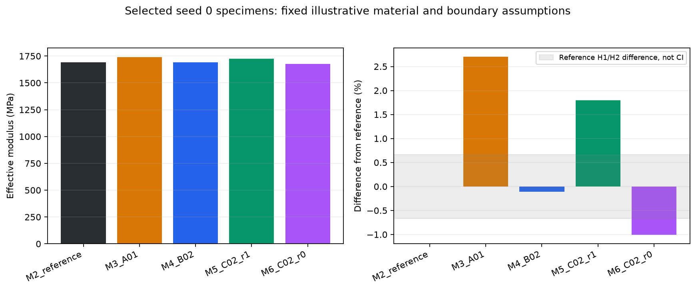

# Morphology and mechanical response

| Specimen | Reinforcement fraction | H1 E (MPa) | E/E_matrix | Signed reference error | Resolution diagnostic |
|---|---:|---:|---:|---:|---|
| M2_reference | 0.31632996 | 1693.288605 | 1.693289 | +0.0000% | Reference |
| M3_A01 | 0.31214905 | 1739.043969 | 1.739044 | +2.7022% | Exceeds observed mesh changes |
| M4_B02 | 0.31553650 | 1691.405496 | 1.691405 | -0.1112% | Unresolved vs mesh changes |
| M5_C02_r1 | 0.31620789 | 1723.642834 | 1.723643 | +1.7926% | Exceeds observed mesh changes |
| M6_C02_r0 | 0.31651306 | 1676.206734 | 1.676207 | -1.0088% | Unresolved vs mesh changes |

| Specimen | Exact seed visible error | Exact seed hidden error | E error magnitude |
|---|---:|---:|---:|
| M2_reference | NA | NA | 0.0000% |
| M3_A01 | 0.0962017 | 0.082539 | 2.7022% |
| M4_B02 | 0.00459301 | 0.0597745 | 0.1112% |
| M5_C02_r1 | 0.00589437 | 0.068677 | 1.7926% |
| M6_C02_r0 | 0.000441619 | 0.110301 | 1.0088% |

These are the actual mechanically evaluated seed 0 descriptors, not ten-seed script means. Reinforcement fraction is reported alongside stiffness; it was never adjusted after generation. A01 has a lower reinforcement fraction yet is stiffer than the target in this selected realization, so fraction alone does not explain the observed ordering. This does not isolate which spatial descriptor causes the response.

The C02 revision changes visible morphology error by +0.00545275, hidden error by -0.0416245, reinforcement fraction by -0.00030518, and modulus by +47.436100 MPa. Measured mechanical agreement is WORSENED on H1: absolute reference-relative error changes from 1.0088% to 1.7926%. On H2 those errors are 0.8667% and 1.8693%. Pairing identifies the parent script and stochastic seed, not individual particles or an identical RNG stream.

For this exact seed, the supplied-descriptor error worsens while the withheld-descriptor error improves. That differs from the prior ten-seed mean supplied-descriptor improvement; those levels must remain distinct. The direction of observed stiffness-agreement change persists across both meshes, but its absolute-error change is smaller than a conservative diagnostic combining twice the reference mesh change and the two specimen mesh changes. Therefore its improvement/worsening is descriptive and is not a numerically certified or causal feedback effect. In particular, the initial C02/reference difference is itself unresolved under the registered sensitivity interpretation.

Observed H1/H2 changes are numerical-sensitivity diagnostics, not rigorous error bounds or confidence intervals. The resolution flag conservatively compares the generated/reference modulus difference against the sum of observed reference and available specimen relative mesh changes. Results flagged unresolved cannot support a resolved morphology-effect claim. No p-values, causal feedback benefit, condition-average ranking or broad generalization is inferred.

The phase properties are illustrative E = 1000/10000 MPa and nu = 0.30, with ideal perfectly bonded interfaces. The1 mm square and1 mm thickness are computational scaling choices, not measured microscopy scale. Native1/5 roles are explicit, but phase 5 chemical identity remains provisional. P3 is a morphology-selected HorizontalFlip augmented SEM crop, not an unbiased RVE. Pixel interfaces are staircase boundaries; refinement changes finite elements within each unchanged pixel, not segmentation resolution. There is one selected seed per generator, not a prompting-condition mean or population estimate. Script selection used prior morphology outcomes. Composition and morphology both vary. No experimental validation, nonlinear contact, failure law, physical yielding, energy absorption, F1 mechanics,3D analysis or LLM mechanical optimization is claimed.
