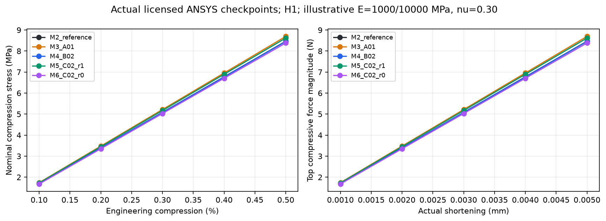
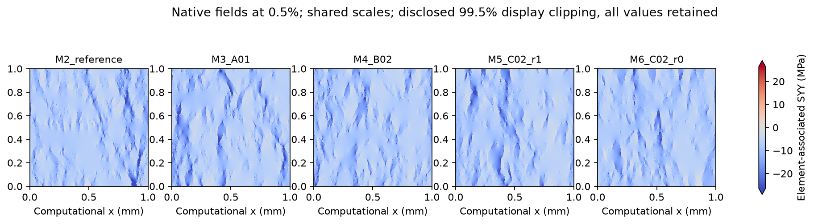
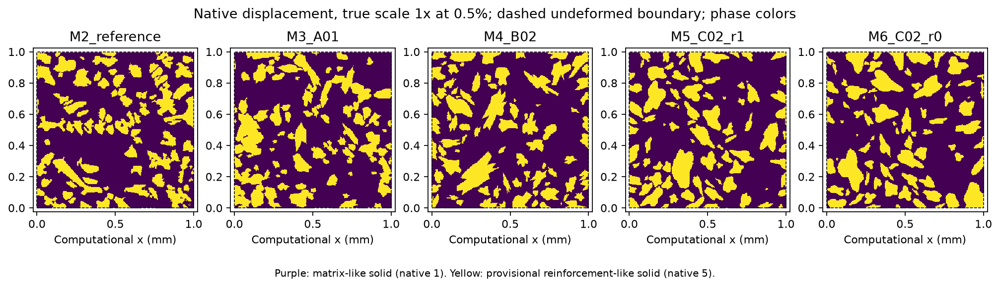

# P3 native mechanical responses

| Specimen | Reinforcement fraction | H1 E (MPa) | E/E_matrix | Signed reference error | Resolution diagnostic |
|---|---:|---:|---:|---:|---|
| M2_reference | 0.31632996 | 1693.288605 | 1.693289 | +0.0000% | Reference |
| M3_A01 | 0.31214905 | 1739.043969 | 1.739044 | +2.7022% | Exceeds observed mesh changes |
| M4_B02 | 0.31553650 | 1691.405496 | 1.691405 | -0.1112% | Unresolved vs mesh changes |
| M5_C02_r1 | 0.31620789 | 1723.642834 | 1.723643 | +1.7926% | Exceeds observed mesh changes |
| M6_C02_r0 | 0.31651306 | 1676.206734 | 1.676207 | -1.0088% | Unresolved vs mesh changes |

Every row uses the same normalized dimensions, constitutive properties, PLANE182 options, direct displacement boundary conditions and five actual 0.1–0.5% native checkpoints. Modulus is an unconstrained slope/intercept fit; secant modulus, residuals and R² are retained. The unloaded origin was not solved and is not plotted as a native result. Independent source RST/database hashes, source logs, per-element fields and reaction exports are bound to each accepted record. Positive engineering compression uses shortening/H and absolute top reaction/(width*thickness).

Element-associated native ETABLE averages retain phase identity; no averaging across material nodes is used. Phase stress means, robust equivalent-stress percentiles, axial strains and energy shares are in phase_fields/PHASE_STRESS_SUMMARY.csv. Element SENE is summed once and agrees with 0.5*F*delta. Native engineering shear is checked against SXY/G. Volume-mean axial stress agrees with the structural boundary reaction.

The phase properties are illustrative E = 1000/10000 MPa and nu = 0.30, with ideal perfectly bonded interfaces. The1 mm square and1 mm thickness are computational scaling choices, not measured microscopy scale. Native1/5 roles are explicit, but phase 5 chemical identity remains provisional. P3 is a morphology-selected HorizontalFlip augmented SEM crop, not an unbiased RVE. Pixel interfaces are staircase boundaries; refinement changes finite elements within each unchanged pixel, not segmentation resolution. There is one selected seed per generator, not a prompting-condition mean or population estimate. Script selection used prior morphology outcomes. Composition and morphology both vary. No experimental validation, nonlinear contact, failure law, physical yielding, energy absorption, F1 mechanics,3D analysis or LLM mechanical optimization is claimed.
