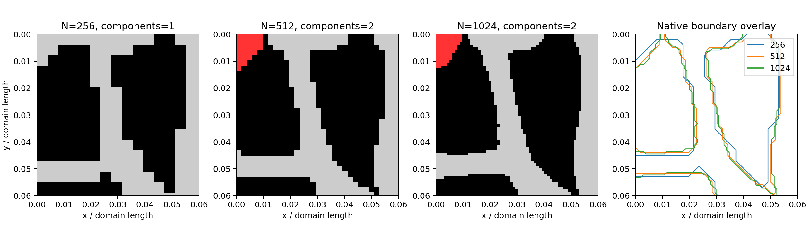

# v0.4.1 diagnostics (before repair)

Signed percentages use the lower-resolution value as denominator.

## Nine originally successful pairs

| Design | Seed | Step | Mean thickness % | P10 thickness % | Pore median % |
|---:|---:|---|---:|---:|---:|
| 0 | 0 | 256 → 512 | -5.8831 | +11.8034 | +0.0000 |
| 0 | 0 | 512 → 1024 | -2.8739 | +11.8034 | -2.1720 |
| 0 | 1 | 256 → 512 | -6.0036 | +11.8034 | +0.0000 |
| 0 | 1 | 512 → 1024 | -2.9157 | +11.8034 | +0.1835 |
| 1 | 0 | 256 → 512 | -6.6079 | +0.0000 | +0.0000 |
| 1 | 0 | 512 → 1024 | -3.6710 | +0.0000 | +0.9570 |
| 1 | 1 | 256 → 512 | -6.9879 | +0.0000 | -4.2790 |
| 1 | 1 | 512 → 1024 | -3.4558 | +0.0000 | +2.1006 |
| 2 | 0 | 256 → 512 | -6.7148 | +11.8034 | +0.0000 |
| 2 | 0 | 512 → 1024 | -2.9876 | +11.8034 | -0.9419 |
| 2 | 1 | 256 → 512 | -6.8447 | +11.8034 | +3.6542 |
| 2 | 1 | 512 → 1024 | -3.3785 | +0.0000 | -0.8491 |
| 5 | 0 | 256 → 512 | -6.2748 | +41.4214 | -4.8028 |
| 5 | 0 | 512 → 1024 | -2.6853 | -9.8612 | -1.5202 |
| 5 | 1 | 256 → 512 | -5.6121 | +41.4214 | -2.3719 |
| 5 | 1 | 512 → 1024 | -2.8377 | -9.8612 | +0.0000 |
| 9 | 0 | 256 → 512 | -6.9747 | +0.0000 | -6.9739 |
| 9 | 0 | 512 → 1024 | -3.4796 | +3.0776 | +0.0000 |

## Analytic fixed-geometry controls

All masks sampled independently. Values are normalized by N. Open bar voids have no enclosed pore.

| Geometry | Width at 256 | N | Mean t/N | P10 t/N | Median pore/N |
|---|---:|---:|---:|---:|---:|
| bar_x | 4 | 256 | 0.01562500 | 0.01562500 | N/A |
| bar_x | 4 | 512 | 0.01560944 | 0.01562500 | N/A |
| bar_x | 4 | 1024 | 0.01562109 | 0.01562500 | N/A |
| bar_x | 6 | 256 | 0.02337500 | 0.02343750 | N/A |
| bar_x | 6 | 512 | 0.02342169 | 0.02343750 | N/A |
| bar_x | 6 | 1024 | 0.02343352 | 0.02343750 | N/A |
| bar_y | 4 | 256 | 0.01556348 | 0.01562500 | N/A |
| bar_y | 4 | 512 | 0.01560937 | 0.01562500 | N/A |
| bar_y | 4 | 1024 | 0.01562108 | 0.01562500 | N/A |
| bar_y | 6 | 256 | 0.02337450 | 0.02343750 | N/A |
| bar_y | 6 | 512 | 0.02342162 | 0.02343750 | N/A |
| bar_y | 6 | 1024 | 0.02343351 | 0.02343750 | N/A |
| bar_45 | 4 | 256 | 0.01739714 | 0.01746928 | N/A |
| bar_45 | 4 | 512 | 0.01655876 | 0.01657282 | N/A |
| bar_45 | 4 | 1024 | 0.01657282 | 0.01657282 | N/A |
| bar_45 | 6 | 256 | 0.02809858 | 0.02816837 | N/A |
| bar_45 | 6 | 512 | 0.02501220 | 0.02501220 | N/A |
| bar_45 | 6 | 1024 | 0.02351464 | 0.02351874 | N/A |
| ring | 4 | 256 | 0.01633336 | 0.01562500 | 0.37928863 |
| ring | 4 | 512 | 0.01585792 | 0.01562500 | 0.38181471 |
| ring | 4 | 1024 | 0.01553291 | 0.01487456 | 0.38303665 |
| ring | 6 | 256 | 0.02354573 | 0.02209709 | 0.37115542 |
| ring | 6 | 512 | 0.02349659 | 0.02277716 | 0.37389975 |
| ring | 6 | 1024 | 0.02332500 | 0.02277716 | 0.37518814 |

## Limited 2048 diagnostic

| Design | Seed | Step | Mean thickness % | P10 thickness % | Pore median % |
|---:|---:|---|---:|---:|---:|
| 1 | 0 | 1024 → 2048 | -1.8670 | -2.3719 | +0.1179 |
| 2 | 0 | 1024 → 2048 | -1.7594 | -7.8046 | -0.2391 |
| 5 | 0 | 1024 → 2048 | -1.5292 | +0.9570 | +0.2774 |

## Detached corner

Pixel-center distance is not an inferred continuous boundary gap.

| N | Components | Detached pixels | Area fraction | Bounding box y,x (inclusive) | Nearest distance (pixels) | Distance / (N-1) |
|---:|---:|---:|---:|---|---:|---:|
| 512 | 2 | 25 | 0.000095367 | [[0, 0], [6, 4]] | 2.000000 | 0.003913894 |
| 1024 | 2 | 91 | 0.000086784 | [[0, 0], [12, 9]] | 3.000000 | 0.002932551 |

Historical inventories unchanged: True.

These diagnostics do not themselves amend acceptance thresholds or establish v0.5 readiness.
