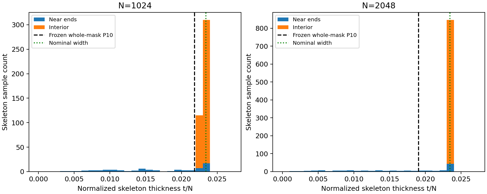

# Analytic P10 outlier — endpoint-population audit

Post-hoc explanation only. The control remains in calibration and frozen whole-mask P10 remains unchanged.

| N | Skeleton samples | Whole-mask P10 | Thin samples (<90% width) | Thin samples near ends | Interior P10 (diagnostic only) |
|---:|---:|---:|---:|---:|---:|
| 256 | 114 | 0.022097087 | 5.2632% | 100.0% | 0.022097087 |
| 512 | 235 | 0.022777156 | 9.3617% | 100.0% | 0.022777156 |
| 1024 | 474 | 0.021836601 | 9.9156% | 100.0% | 0.022777156 |
| 2048 | 967 | 0.019070316 | 11.2720% | 100.0% | 0.023150917 |

The thin-sample population crosses 10% between 1024 and 2048. That moves whole-mask P10 into the endpoint tail despite unchanged analytic geometry.
The interior statistic is not substituted for evaluator v1.1 or used to retroactively pass the control.

