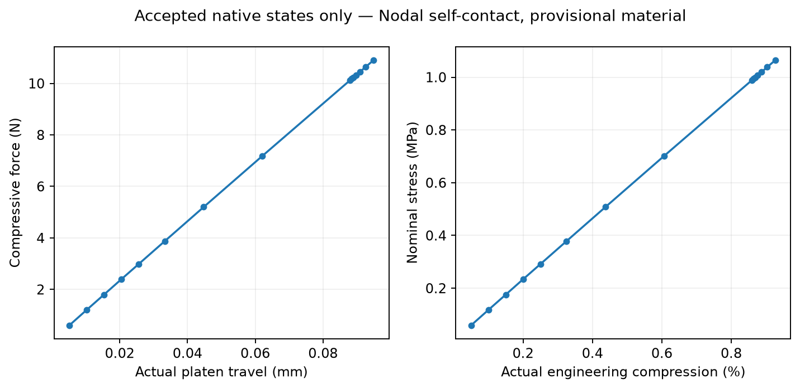
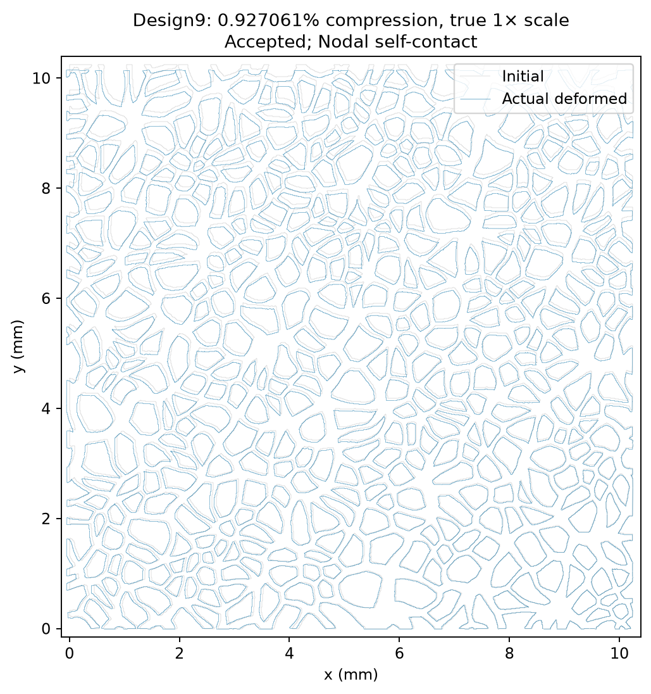

# v0.6.6 scientific validation

## A. Executive summary

Scientific status: **PROGRESSIVE_FINE_MESH_RESEARCH_HOLD__TARGET_NOT_REACHED**. Highest independently qualified strain across branches: **0.927060884%**. Highest completed native strain: **1%**; convergence alone does not establish qualification. Primary branch `FINE_FULL_SELF_CONTACT_NODAL_V066_021` is qualified through **0.927060884%**.

Stop reason: The registered 30-minute limit without a new converged state stopped the single bounded contact-onset retry after 3019.84 s. Force residuals kept cycling during the next contact-active trial despite one native bisection. No 1% endpoint passed; 5–40% stages were not executed. This is a numerical contact/control limit under the registered budget, not a demonstrated material-collapse limit.

Thirty percent primary target: NOT REACHED. Forty percent stretch: NOT REACHED. All reported curves stop at actual qualified points. The distinct contact-model branches are never spliced.

## B. Model identity

Design9, seed 1, native 1024 canonical polygon source. Source SHA256 `4700d4581d2f86c19e382eb2406a57f98724e478c3391acc4d3dc0425d4b8dc1`; fine mesh semantic SHA256 `e26863263774cf86c777b1485ac0e639216a91644007c4da272469a7447000bc`. Structural nodes 2,766,505; structural TRI6 elements 1,261,670; all 412 original pore loops. Original minimum angle 11.404135 degrees exceeds frozen 10 degrees. Original sampled feature rule >=3; selected fine observed minimum 7. All original quadratic mappings qualified. Full model additionally has 2,598 platen contact skins, 4 rigid target/pilot elements and 243,576 native GC skins, with 6 auxiliary platen nodes. These overlays do not replace the original continuum mesh.

Licensed ANSYS Mechanical APDL 2024 R1, 2D plane stress, mm-N-MPa, width/height 10.24 mm and provisional thickness 1 mm. Provisional E=1000 MPa, nu=0.3 linear elasticity, NLGEOM ON. No material calibration, plasticity, damage, fracture, out-of-plane buckling or experimental prediction is established. Native local strains are monitored, but supported corner averages can understate integration-point extremes. Pixel-boundary stress concentrations and force curves remain unqualified for mesh convergence.

## C. Large-strain protocol

Displacement-controlled quasi-static pseudo-time, total upperUY=-10.24*engineering_strain mm. Full Newton, line search, AUTOTS, NEQIT=24, force CNVTOL=0.005/norm 2/minimum reference 1e-8; initial increment <=0.0005, maximum 0.005, minimum 1e-6. Sparse DEFAULT memory selection, actual licensed SMP settings recorded in receipts. No fixed RSS cap; system available/committed memory and paging HealthPolicy, 40 GiB free-disk reserve, one native job at a time, original six-hour campaign/90-minute stage/30-minute no-progress bounds. The qualified numerical restart frequency is 1, with three rolling frames; the legacy ALL-frequency retention deviation is explicitly documented. A single same-nodal-model contact-onset recovery used native ENDSTEP at the accepted intermediate frame, then NEQIT=12, initial global increment 5e-5, maximum 2.5e-4 and minimum 1e-6. Its native input, actual outcomes and finite 60-minute bound are recorded under protocol 025. The original nodal 1% trial was deliberately interrupted after oscillation; a predictive native bisection occurred just before the ABT was acknowledged. Its seven converged states remain independently accepted, while SS999999 is debug-only.

## D. Mesh strategy

The one smaller exact-geometry candidate had 1,383,233 nodes/610,630 TRI6 and a 2.066 element-count reduction, but failed 10 degrees with 8.3031647757 degrees. It was rejected without a mechanics benchmark. No accepted coarse/fine sensitivity or mechanical mesh convergence was established. The fine mesh remains intact.

## E. Contact model

Small fixture qualified; full 243,576-skin model implemented. Actual full accepted engagement: No; accepted full-model records remain open with zero pressure. See V0_6_6_INTERNAL_CONTACT.md. The platen-only 1% state is rejected for two confirmed free-boundary crossings. Separate model branches are never spliced. The default Gauss-point GC014 1% state also fails exact boundary crossing checks; its valid predecessor remains preserved. The single nodal repair is separately identified in protocol 021 and the contact report.

## F. Restart qualification

Rectangle and compliant continuous/restarted histories and fields passed the registered 1e-5 scaled tolerance. Genuine v065 native continuation executed before the full-GC corrective fresh model. Actual native frame inventories expose the legacy endpoint-only retention deviation. Numeric frequency 1 was separately demonstrated to retain the last 3 of 5 substeps. All parents are immutable authenticated copies. Last valid restart: fine_nodal_recovery01_001, load step 3/substep 6, strain 0.0092706088362069, frame compression.r001; authenticated RDB/LDHI/Rnnn and native fields in restart_validation/FINAL_VALID_NATIVE_RESTART.json.

The additional native ENDSTEP/controller comparison passed: the preserved prior-state fields were byte-identical, and the largest final column-scaled difference was 1.3650661e-7 against the unchanged 1e-5 tolerance. The first retention-only reference lacked an intermediate RST set; that failed readback is preserved, and the corrected five-state reference writes all required fields. See restart_validation/ENDSTEP_CONTROL_QUALIFICATION.json and audit 027.

## G. Progressive mechanical results

| Engineering compression fraction | Travel mm | Upper RF N | Lower RF N | Nominal stress MPa | Signed imbalance fraction | Secant MPa |
|---|---|---|---|---|---|---|
| 0.0005 | 0.00512 | -0.6039598776 | 0.6075600911 | 0.0589804568 | 0.005925691204 | 117.9609136 |
| 0.001 | 0.01024 | -1.203355235 | 1.202968495 | 0.1175151597 | 0.0003213851482 | 117.5151597 |
| 0.0015 | 0.01536 | -1.79775728 | 1.794248435 | 0.1755622344 | 0.001951790059 | 117.0414896 |
| 0.002 | 0.02048 | -2.394127853 | 2.38952216 | 0.2338015482 | 0.001923745766 | 116.9007741 |
| 0.0025 | 0.0256 | -2.984222322 | 2.983730001 | 0.2914279611 | 0.0001649747288 | 116.5711844 |
| 0.00325 | 0.03328 | -3.872668942 | 3.872656431 | 0.3781903264 | 3.230697364e-06 | 116.3662543 |
| 0.004375 | 0.0448 | -5.200910085 | 5.203892937 | 0.5079013755 | 0.0005731963446 | 116.091743 |
| 0.0060625 | 0.06208 | -7.18060304 | 7.180412866 | 0.7012307656 | 2.648444458e-05 | 115.6669304 |
| 0.00859375 | 0.088 | -10.12260211 | 10.12195318 | 0.9885353621 | 6.410673519e-05 | 115.0295694 |
| 0.008642241379 | 0.08849655172 | -10.17841266 | 10.17829922 | 0.9939856109 | 1.114497601e-05 | 115.0147939 |
| 0.008690732759 | 0.08899310345 | -10.23396396 | 10.2339637 | 0.9994105431 | 2.589606333e-08 | 114.9972702 |
| 0.008763469828 | 0.08973793103 | -10.31795284 | 10.31795321 | 1.007612582 | 3.551030933e-08 | 114.9787244 |
| 0.008872575431 | 0.09085517241 | -10.44389105 | 10.44389045 | 1.019911235 | 5.73799292e-08 | 114.9509794 |
| 0.009036233836 | 0.09253103448 | -10.63267798 | 10.63267605 | 1.038347459 | 1.810893243e-07 | 114.909317 |
| 0.009270608836 | 0.09493103448 | -10.90307047 | 10.90287636 | 1.064752975 | 1.780304805e-05 | 114.8525403 |

Initial fit: {'effective_modulus_MPa': None, 'minimum_points': 3, 'points': 2, 'registered_interval': [5e-05, 0.001], 'status': 'INSUFFICIENT_POINTS'}. Preserved reference fit: {'R_squared': 0.9999995892388926, 'effective_modulus_MPa': 117.13641689053354, 'minimum_points': 3, 'normalized_modulus': 0.11713641689053354, 'points': 4, 'registered_interval': [5e-05, 0.001], 'status': 'PRELIMINARY_SINGLE_MESH_THROUGH_ORIGIN_FIT'}. Work: {'limitation': 'Accepted states of this model only, on observed interval; sparse quadrature is not an energy/dissipation convergence study. No origin extrapolation.', 'points': 15, 'status': 'OBSERVED_INTERVAL_TRAPEZOIDAL_ESTIMATE', 'travel_interval_mm': [0.005120000000000001, 0.09493103448275862], 'work_J': 0.0005194930414848452, 'work_N_mm': 0.5194930414848452}. Peak computed primary force 10.90307046622248 N; nominal stress 1.064752975217039 MPa. No values are generated for missing major strains.

## H. Deformation

See actual native field hashes, pore areas and true-scale figures in V0_6_6_DEFORMATION_RESULTS.md and figures/manifest.json. Highest local strain diagnostics: [[0.0008435365603147336, 0.0008894490505356623], [0.008768475679518512, 0.005775016895431124], [0.015027924476501697, 0.00997616389286089], [0.06697386560717862, 0.04643379938455647]].

## I. Numerical validity

Accepted states independently reopen native RST using the actual LS/SS and full-precision TNOW. Require complete all-node U, native corner SYY/SEQV/EPEL Y/X, signed support imbalance<=1%, independent platen contact-force opposition<=1%, positive pressure/engagement, stored endpoint penetration<=1e-5mm, every deformed TRI6 map positive, and no unexplained boundary crossing. Whole-element ETABLE NMISC19 inventories distinguish native far-field record absence from missing active data; every missing platen far-field edge must independently clear the finite platen by analytic quadratic bounds. Full-GC contact intersections require actual closed positive-pressure native links or the prospectively registered bounded nodal shared-endpoint explanation, plus native assembled force balance. Pure geometric separation never supplies a contact force. No default/ignored/sentinel result values establish acceptance.

Maximum primary signed reaction imbalance:0.005925691204477038. Native states/updates/cutbacks are separately counted. Failures/stops: [{'controlled_native_ABT_requested': False, 'job': 'fine_nodal_recovery01_001', 'last_converged': {'load_step': 3, 'pseudo_time': 0.00927061, 'source_line': 3325, 'substep': 6, 'time_increment': 0.000234375}, 'returncode': 15, 'status': 'NO_CONVERGED_PROGRESS_TIMEOUT'}, {'controlled_native_ABT_requested': True, 'job': 'fine_nodal_stage02_001', 'last_converged': {'load_step': 2, 'pseudo_time': 0.00859375, 'source_line': 3834, 'substep': 7, 'time_increment': 0.00253125}, 'returncode': 15, 'status': 'NATIVE_SOLVER_ERROR_OR_DISTORTION'}]. Earlier complete sets are evaluated from their own native log segment; later warnings do not retroactively fabricate or destroy a prior field. The failed recovery passes remain in audit.

## J. Physical limitations

Licensed ANSYS Mechanical APDL 2024 R1, 2D plane stress, mm-N-MPa, width/height 10.24 mm and provisional thickness 1 mm. Provisional E=1000 MPa, nu=0.3 linear elasticity, NLGEOM ON. No material calibration, plasticity, damage, fracture, out-of-plane buckling or experimental prediction is established. Native local strains are monitored, but supported corner averages can understate integration-point extremes. Pixel-boundary stress concentrations and force curves remain unqualified for mesh convergence.

Native numerical convergence is not material calibration, mesh convergence, experimental validation, manufacturing readiness or a prediction of yield/fracture. Large native local strains strengthen these limitations.

## K. Performance

Total native process runtime 11429.3 s; fine source runtime 9974.82 s; peak native process-tree RSS 25.2793 GiB. Severe-paging samples 0; maximum page-read rate 9364.003673036066. Raw v066 tree disk 136.786 GiB, including preserved/copy parents and diagnostics. Scope and per-job data are in performance/PERFORMANCE.json. Page Reads/sec is a system hard-fault disk-read proxy, not solver-only or pagefile-only traffic; zero severe-threshold samples does not mean zero paging. No fixed RSS cap was used. The six-hour budget constrained fine-solve launches/timeouts; the final read-only recovery and documentation were completed on the later user continuation, without another nonlinear solve.

## L. Reproducibility and verification

Native input/receipt/RST/database/mesh/geometry bindings are explicit in each source/export manifest. Source and read-only execution are separate. Active tests: {'errors': 0, 'failures': 0, 'passed': 794, 'skipped': 0, 'tests': 794}; archived replay:475 passed across 9 groups; licensed checks: {'errors': 0, 'failures': 0, 'passed': 104, 'skipped': 0, 'tests': 104}. These categories overlap and are not summed. Protected historical files unchanged: True. Nothing was pushed.

| Independent category | Actual status |
|---|---|
| A_GEOMETRY_AUTHENTICATED | PASS |
| B_MESH_QUALIFIED | PASS_ORIGINAL_FINE_GATES |
| C_RESTART_VERIFIED | PASS_ACTUAL_LICENSED |
| D_MULTI_POINT_OUTPUT_VERIFIED | PASS_ACTUAL_LICENSED |
| E_PLATEN_CONTACT_QUALIFIED | PASS_ACCEPTED_STATES |
| F_INTERNAL_CONTACT_IMPLEMENTED | PASS_FULL_NATIVE243576_SKINS |
| G_INTERNAL_CONTACT_DEMONSTRATED | SMALL_FIXTURE_ONLY |
| H_INTERNAL_OVERLAP_SCREENED | PASS_BOUNDED_SCREEN_ACCEPTED_STATES |
| I_PROGRESSIVE_COMPRESSION_EXECUTED | PASS |
| J_FIRST_ONE_PERCENT | NOT_ACHIEVED |
| K_FIRST_FIVE_PERCENT | NOT_ACHIEVED |
| L_FIRST_TEN_PERCENT | NOT_ACHIEVED |
| M_FIRST_TWENTY_PERCENT | NOT_ACHIEVED |
| N_THIRTY_PERCENT_TARGET | NOT_ACHIEVED |
| O_FORTY_PERCENT_STRETCH | NOT_ACHIEVED |
| P_MULTI_POINT_STRESS_STRAIN | PASS |
| Q_DEFORMATION_FIELDS | PASS_ACTUAL_NATIVE_FIELDS |
| R_MECHANICAL_MESH_CONVERGENCE | UNQUALIFIED |
| S_MATERIAL_CALIBRATION | UNQUALIFIED |
| T_PAPER_READINESS | RESEARCH_HOLD |
| U_LLM_OPTIMIZATION | NOT_IMPLEMENTED |

## M. Git commits

Base ce6f601da40784621f3324b7e5805983704973b9. Ledger through the parent of this report commit:

- 63886a743334c1c783dc169bc0a0e40cee078165 docs(fem): register v0.6.6 progressive large-strain compression protocol
- c9d8099f55738ba0808226a11cf6e5e002ce4a46 feat(ansys): verify native restart and multi-checkpoint compression output
- 2e9f39f8f0131f69bee2d90bfec5370f3d5bd620 feat(fem): screen quadratic boundary overlap and reject unqualified coarse/contact candidates
- d6aba1ef56cbf5c5bf6a34866ee981b39d5d5826 feat(ansys): freeze authenticated fine-mesh progressive compression campaign
- 6af10a96a3516891ec0bcaa9d167f35cb46484bb feat(fem): independently qualify progressive native states and retain partial-job evidence
- 5d3b8dd6b328c49217a41f43965c9976286f466b fix(validation): repair relocated Python environment and prepare shorter-gap contact control
- 41cd832da156261a12d52544ebbfb227b266dd7b fix(fem): quarantine absent continuum strain fields under nonzero load
- dfda76c00e69a249ae80a8b33fb49721895038bb feat(ansys): accept four fine-mesh response points and gate continuation toward one percent
- d1024d2516fc3287418a6f5967c6e73afbba5538 feat(contact): demonstrate gap-closing general contact with opposing forces and bounded penetration
- 2095ed2ad81f50bac2b0b58467f7a0670b2af9be feat(results): render native deformation and response with reproducible resource summaries
- 087f9e3f57572d0536204b159153421cc6770db4 perf(ansys): register authenticated full-node vector export benchmark
- b3de7bbedd1a549ebcdcd26033394ee7457c09a1 perf(ansys): verify identical native fields with faster bounded export and correct restart inventory
- cbd4481ba6f120944d36d55888080c54ce732790 feat(contact): qualify native far-field records and diagnose self-crossing before full self-contact repair
- 72f6fc1947ff6bf6addaed951893964a437bb49e feat(ansys): verify full self-contact skin coverage and prepare fresh fine-mesh compression
- 71609b4288a570e30f5ab4c179e8d7f21a377f4d feat(ansys): qualify full self-contact output and preserve the initial fine-mesh response
- 2b37e74872cb4007c28de8f26d66516ad9232834 perf(ansys): register licensed SMP scaling verification before larger stages
- 9b5dda113686fab754bd159bd30983ff8d0c7b01 Qualify nodal self-contact fixture and freeze fresh fine-mesh repair
- 98aff0deefe0589fccf8d15536af3160f95e10f6 Reject Gauss contact endpoint crossings and preserve separate qualified response branches
- ac1ee24a8b73cd96e9b49ee6973486f4a8374ce8 Verify native contact repairs and bind continuation to its actual protocol
- 2b93ebd91e9e4753efec0e2842a76a469fb1430c Screen every saved nodal-contact checkpoint before further compression
- 632b3797b5eae374b26e5e376201d2e15cce59de Record 784 passing active tests after contact and output repairs
- db391ab7e57ad6c0af3bdd1f19a9dd00b067cf4c Preserve qualified 0.859375 percent fields and branch-specific mechanical response
- 7147dad5c64b14f9ec2dff20a5c3867c2d3fe1cb Show exact rejected Gauss-contact crossings with explicit diagnostic axis scales
- cce99b227aba028401154a49e10e49bcaa985332 Accept nodal fine-mesh baseline and freeze genuine continuation to one percent
- c24955bb374e72e7487b8c6f51bdb9eda7a1724d Bind highest valid Gauss-contact state to its retained native restart frame
- f39e33ef089f40ead5bfdf24cc0100099008fac2 Retain readable native contact-option inventories alongside authenticated fields
- a678bd34f10c1b1178edd09a69da1d79418424fc Prepare evidence-driven eight-report handoff and preserve all 98 requested questions
- 38f93788f24361538de052715d37208a8653c004 Qualify bounded nodal contact explanations against actual fixture and known crossings
- 0676e48900561e6360ae188c1177995219070405 Record 791 active passes and native nodal-contact geometry integration check
- b057d732d84173511c0f0fbc49ebc32394bdd0be Require a fully qualified loading trajectory and authenticate parent qualification
- 5dc37fb408c7e7258a50077c587a44e6d474cf29 Authenticate figure reuse and preserve separate nodal baseline response
- f9d8ffd76719024f61117b87fbcdeefc3152612c Record 793 active passes including continuous-trajectory acceptance controls
- 6dfb1879c2690875205f2883473a6eb5e83db40e Polish measured-result reports and distinguish fixture and microstructure evidence
- fae5d8e7e7ef075fdb5f7ae037ecc50db6d08fae Register one bounded native contact-onset loading-control recovery
- 91d7a6f2ab50af59ea4caac5f492924aef78d5a1 Prepare authenticated ENDSTEP recovery and preserve controlled nonlinear interrupt
- b1df1930a54fca56f9b8c32099d3197dd40a8468 Preserve missing-probe-field failure and prepare complete ENDSTEP comparison
- 399559dd9ef519be6ce0e1ddf6a3fade9411cc25 Preserve complete five-state reference and freeze ENDSTEP controller comparison
- 0a017e933e8d4bfd94dff1234f138271b939fa0e Qualify native ENDSTEP recovery and freeze single fine-mesh onset retry
- 79aa738f3808636c8da80f0c5d13a49e8b652355 Preserve qualified 0.927061 percent fields and close bounded contact-onset attempt

The containing report commit and final clean-tree verification are identified in the delivery response/Git history; a commit cannot embed its own hash.

## N. Next milestone

Resolve convergence through the sharp exterior contact-onset region in a geometry-faithful local fixture, retaining signed force, penetration and overlap limits, then replay the full fine mesh. Qualify any changed contact formulation before further 1→5→10→20→30→40%loading. Mechanical mesh convergence and calibrated material/thickness/experiments remain required for a paper dataset. Controlled LLM iteration additionally requires repeatable qualified mechanical datasets, uncertainty handling and explicit feedback safeguards. No batch FEM,3D,manufacturing or autonomous optimization was started.
